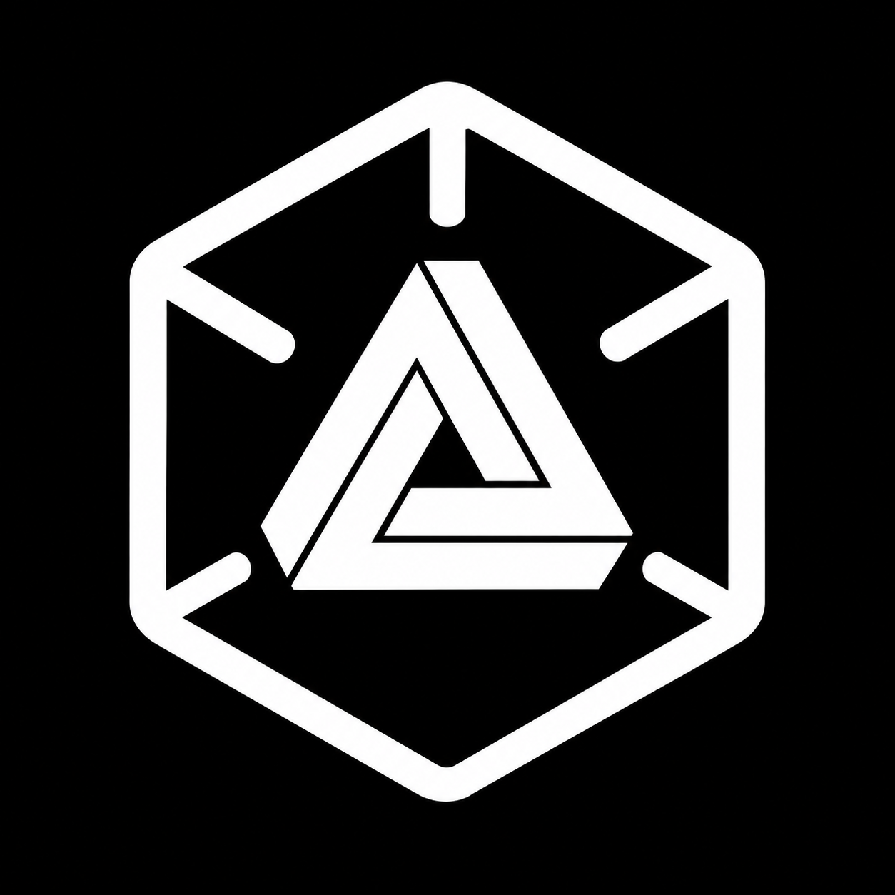
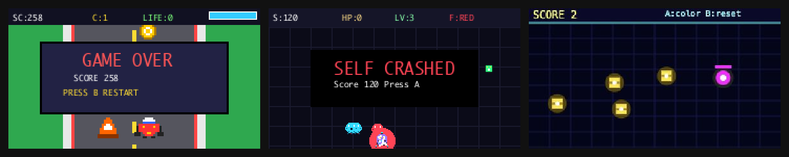
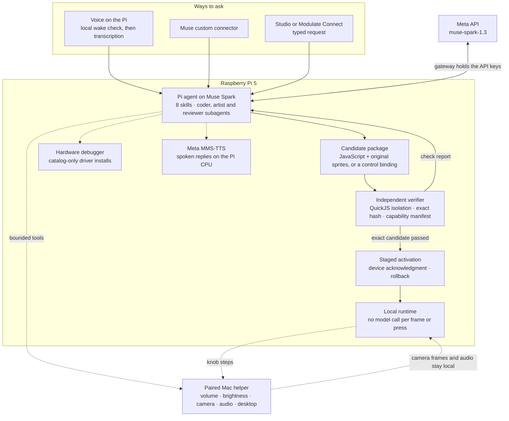

<p align="center">
  
</p>

<h1 align="center">Modulate</h1>

<p align="center"><strong>Say what it should become.</strong></p>

<p align="center">
Modulate is a Raspberry Pi device you program by talking to it. A Meta Muse Spark agent sees which components are connected, writes the app or control mapping for that hardware, verifies it in a sandbox, repairs failures, and activates it with acknowledgment and rollback. The result then runs locally, with no model call per frame or press. On our device, single requests have produced playable games, turned a knob into a Mac volume control, and switched a game to tilt steering after an IMU was added.
</p>

<p align="center">
  <a href="https://modulate-connect.vercel.app/demo"><strong>Try it in your browser →</strong></a>
  &nbsp;·&nbsp; <a href="https://modulate-connect.vercel.app/connect">Connect a real device</a>
  &nbsp;·&nbsp; <a href="#how-it-works">Architecture</a>
  &nbsp;·&nbsp; <a href="#evidence">Evidence</a>
  <!-- TODO(team): add the 3-minute demo video link here before submitting -->
</p>

<p align="center">
  
  <br>
  <sub>Saved frames from Meta-generated apps: Pixel Kart Sprint (typed, Pi) · MODULATE: Self Assembly (spoken, Pi) · Neon Courier (online demo). Rendered package output, not photos.</sub>
</p>

<p align="center"><sub>Meta Global AI Developer Hackathon · Theme: Push the Frontier · Track: Indie Developer</sub></p>

## What it does

Demonstrated on our Raspberry Pi 5 with live Meta models. Input modes are labeled; timings are in [Evidence](#evidence).

- **Builds a game from a sentence.** A spoken "Make yourself" produced *MODULATE: Self Assembly*, with fresh code and four original sprites. The first typed request produced *Pixel Kart Sprint*, which the user played with the joystick and buttons. [Spoken run](context/product-runtime.md#further-spoken-game--october-28) · [first game](context/evidence/first-live-game.json)
- **Turns a knob into a Mac control.** A typed request bound the knob to the paired Mac's system volume. Spoken "Make the knob less sensitive" (push-to-talk) and "Hey Meta, reverse the knob" (hands-free) refined it. A later typed request made it dim and brighten the Mac screen. [Volume](context/product-runtime.md#live-volume-and-spoken-refinements--october-28) · [brightness](context/evidence/mac-reconnect-2026-11-02.json)
- **Adapts when the hardware changes.** With the joystick unplugged, the Pi automatically had Meta rework the saved game for the knob. After an IMU was added, a typed request switched it to tilt steering. The user confirmed both. [Adaptive controls](context/adaptive-controls.md)
- **Fixes its own hardware setup.** With the IMU driver deliberately removed, a typed request had the agent verify the chip, install a hash-pinned driver pack and return real readings. It also diagnoses the I²C bus and guides Qwiic-button address changes; the full address write has only run on a simulated bus. [Driver setup](context/driver-setup.md) · [debugger](context/hardware-debugger.md)
- **Turns into a camera mirror or a Mac speaker.** A typed request generated *Funky Mirror Cam*, which shows the Mac's live camera with effects on the mini display. A typed "Turn into a speaker for my computer" streamed Mac audio to the Pi; a spoken "Hey Meta, stop being a speaker" handed it back. Both user-confirmed. [Camera](context/product-runtime.md#paired-mac-and-live-camera-extension) · [speaker](context/evidence/computer-audio.json)
- **Uses the Mac like a person would.** From screenshots and native cursor and keyboard input, it read the newest Gmail message aloud after a spoken request and operated Calculator from typed ones. No Gmail API; these were individual trials. [Computer tasks](context/product-runtime.md#computer-tasks-and-spoken-replies)
- **Keeps a library of what it built.** Every acknowledged app is saved, with favorites and Trash, and re-verified when reopened. The user browsed it with the knob and A/B buttons; a spoken "Hey Meta, reverse the knob here" flipped its scrolling. [App library](context/app-library.md) · [trial](context/evidence/wake-library-preferences.json)
- **Takes requests from Muse.** A Muse chat asking for a "mario kart clone on modulate" reached the Pi agent through a private custom connector; the agent generated, checked and activated *Pip Kart Turbo*. [Muse connector](context/muse-connector.md)

## Try it online

**[modulate-connect.vercel.app/demo](https://modulate-connect.vercel.app/demo)**: no hardware or account needed. Each scene of the three-minute video has a numbered button, in order.

- **Real agent, virtual parts.** Your request and the attached virtual parts go to Meta `muse-spark-1.3`. An orchestrator call picks a skill and one action. For apps, a coder subagent writes original JavaScript and a reviewer subagent approves it or repairs it against the check report. The trace streams onto the page as it happens.
- **The same verification idea as the device.** Generated code runs in a QuickJS/WASM worker with no DOM, network, imports or host callbacks. The server and your browser each run 151 frames before activation; sandbox errors name the failing line so the reviewer can repair it. A rejected candidate leaves the previous app running.
- **Scenes:** a Doom-style game that turns with tilt; unplug the joystick and ask it to update the controls; break the simulated I²C bus (an IMU without its driver, or a third button at 0x6F) and ask it to check your hardware; map the knob to a virtual Mac's brightness from a Muse-style message, then reverse it; a webcam Halloween mirror; the app library with favorites, Trash and knob or joystick scrolling; an unsafe request it declines.
- **Spoken replies, optional.** Turn on the voice and Meta's open-weight MMS-TTS runs in your browser through WebAssembly, as it runs on the Pi's CPU. It's a one-time download of about 42 MB, and reply text never leaves the tab.
- **Honest labels.** The Pi parts, I²C bus, driver installer and paired Mac are simulations; the Meta inference, the generated code and its checks are real. The "Message from Muse" channel is typed on the page, not sent from the Muse app. Webcam frames, if you allow them, stay in the tab and never reach the model or the generated code.
- **Bounded spend.** An independent, capped $25 demo budget reserves worst-case cost before every call, and each visitor has a small daily allowance. Saved apps, knob mappings and the library work without it.

## How it works

The agent runs on the Pi and reaches Meta through a gateway that holds the API keys. It reads the live capability manifest, loads one of [eight skills](modulate/skills), and chooses among [21 trusted tools](modulate/agent.py) such as `inspect_capabilities`, `write_package`, `test_package`, `activate_package`, `hardware_debug` and `computer_act`. There is no keyword router or fixed call sequence. Up to two coder, artist or reviewer subagents share the request's 32-call budget and cannot activate anything. Only the fixed verifier, never the model, can pass a package.



**Trust boundaries**

- **Generated apps are sandboxed.** A QuickJS-NG worker gives them no host callbacks, files, network, imports or shell, under a macOS sandbox or Linux seccomp filter with fixed CPU, memory and drawing limits. Drivers and firmware are out of reach. [Contract](context/product-runtime.md#generated-package-and-execution-contract) · [verifier](modulate/game_runtime.py)
- **Checks bind to the exact package.** The verifier runs startup, representative input updates and hostile resource probes, then records the package and capability-manifest hashes. Activation rejects any change and waits for the device's matching acknowledgment. On failure the previous app keeps running, and rollback needs no model call. [Verification](context/architecture.md#packages-and-verification)
- **Drivers come only from a hash-pinned catalog.** `install_driver` takes a catalog ID (one pack today), re-checks the chip, verifies wheel hashes and requires real readings before committing. It accepts no model-supplied URL, command or code. [Installer boundary](context/driver-setup.md#trusted-installation-boundary)
- **Keys stay server-side.** Provider API keys live only in the server environment. The Pi holds a gateway credential; browsers, generated apps and the Mac helper get none. [Standalone setup](context/standalone.md)
- **Mac access needs a physical press.** Pairing requires matching codes and a press of the Pi's A button; sessions expire after eight hours and can be revoked. Generated mappings can only use advertised volume or brightness steps (±10 at most). [Mac helper](context/optional-mac.md)
- **Camera frames never enter model input.** They travel as local JPEGs to the trusted Pi renderer; the model sees camera metadata only. Screenshots for a requested desktop task do go to Meta, transiently. [Camera path](context/product-runtime.md#paired-mac-and-live-camera-extension)
- **Every model call is reserved in advance.** The [ledger](modulate/agent.py) holds a worst-case reservation before each call and settles actual usage after; unknown costs stay held. The device has a $50 total ceiling; the online demo has its own $25.

## Meta AI in Modulate

| Model | Where it runs | What it does | Evidence |
| --- | --- | --- | --- |
| **Muse Spark** `muse-spark-1.3` | Meta API, called by the Pi agent through the key-holding gateway, and by the `/demo` server | Orchestrator and coder/artist/reviewer subagents: reads capabilities, writes and repairs apps and mappings, reads check reports, drives the Mac from screenshots | [First game](context/evidence/first-live-game.json) · [online demo](context/evidence/online-demo/live/verification.json) |
| **Muse Voice Transcribe** `muse-voice-transcribe-1.0` | Meta API, same gateway | Transcribes invoked commands, push-to-talk and clarification answers after a local wake check | [Integration](context/muse-voice-transcribe.md): synthetic command transcribed end to end in 1.18 s; not yet tested with a person speaking |
| **wav2vec 2.0** `facebook/wav2vec2-base-960h` | Local CPU worker, pinned open weights (Apache-2.0) | Wake recognition, cancellation and local-mode command transcription | [Development-host inference](context/evidence/meta-speech.json); physical wake verification pending |
| **MMS-TTS** `facebook/mms-tts-eng` | Pi 5 CPU, and the visitor's browser (WASM) in the online demo; open weights (CC-BY-NC-4.0) | Spoken replies without a cloud call | [Setup](context/meta-mms.md): user confirmed clear speech; 8.3 s cold synthesis for 3.6 s of audio |
| **Muse** custom connector | Muse → Modulate Connect API → Pi agent | Sends requests and follow-up answers to the Pi agent under a revocable seven-day grant | [Connector](context/muse-connector.md) |
| **Llama 3.2 1B** via Ollama | Pi 5, on device | First voice-to-number prototype only (Oct 28) | [Prototype](context/number-prototype.md) |

Current source uses pinned local Meta wav2vec 2.0 for wake recognition and cancellation, and defaults spoken replies to Meta MMS. Silero remains the explicitly non-Meta speech-activity detector. The new recognizer has development-host inference evidence but has not been installed or tested on the physical Pi; synthesized wake phrases were misheard. Earlier physical voice trials used the prior recognition stack. [Speech setup and limitations](context/meta-speech.md) · [Meta MMS](context/meta-mms.md)

## Evidence

One recorded trial per row on the physical Pi unless noted. Sanitized traces are in [`context/evidence/`](context/evidence). Times run from request submission (after transcription, for spoken rows) to agent completion; they exclude microphone capture and speech playback.

| Capability | Input | Measured result | Link |
| --- | --- | --- | --- |
| First generated game, *Pixel Kart Sprint* | Typed | 49.8 s, 11 Meta calls; a malformed write was repaired by a coder subagent; user played it; 13.4 fps | [Trace](context/evidence/first-live-game.json) |
| Spoken game, *MODULATE: Self Assembly* | Spoken | 37.9 s, 8 calls, four original sprites, about 13 fps | [Runtime log](context/product-runtime.md#further-spoken-game--october-28) |
| First-person game, *Rust Pit 2.5D* | Typed | First attempt rejected after 76.8 s, previous app kept; after a schema-diagnostics fix, 148.5 s and 13 calls; "bubbles" edit 27.3 s | [Rehearsal](context/demo-readiness.md) |
| Game requested from Muse, *Pip Kart Turbo* | Connector | 97.3 s, 13 calls; checks and device acknowledgment passed; physical play not retested | [Connector](context/muse-connector.md) |
| Online demo, *Neon Courier* | Typed, browser | 32.2 s, 2 calls; joystick play, score 0 → 2 | [Verification](context/evidence/online-demo/live/verification.json) |
| Online demo agent, Doom-style *CRIMSON KEEP* | Typed, browser | 81.1 s, 3 calls, $0.049; orchestrator chose tilt to turn; check failed (frame limit), reviewer repaired, repair passed 151 frames | [Scene runs](context/evidence/online-demo/scenes-2026-11-03.json) |
| Online demo: joystick unplugged → "update the game" | Typed, browser | 29.8 s, 3 calls, $0.029; edit moved walking to the knob, kept tilt; approved first time | Same |
| Online demo: knob → virtual Mac brightness, then "reverse the knob" | Muse-style message, then typed | 3.6 s and 4.3 s, one call each; step +2 → −2, applied locally per detent | Same |
| Online demo: missing IMU driver, "check my hardware" | Typed, browser | 4.4 s decision → trusted simulated install; game resumed | Same |
| Online demo: button conflict at 0x6F, "check my hardware" | Typed, browser | 3.8 s decision → guided re-address to 0x6D after three human confirmations | Same |
| Online demo: Halloween mirror | Typed, browser | 63.1 s, 3 calls, $0.037; check failed, reviewer repaired; camera path checked with a synthetic stream | Same |
| Online demo: RFID badge cloner | Typed, browser | Declined in 3.7 s with a harmless alternative; nothing changed | Same |
| Knob → Mac system volume | Typed | 6.6 s, 6 calls; direction user-confirmed; OS volume read back natively | [Runtime log](context/product-runtime.md#live-volume-and-spoken-refinements--october-28) |
| "Make the knob less sensitive" | Spoken, push-to-talk | 5.9 s; scale +2 → +1 | Same |
| "Hey Meta, reverse the knob" | Spoken, hands-free | 4.5 s; scale +1 → −1 | Same |
| Knob → Mac brightness | Typed | 17.8 s, 6 calls; user confirmed both directions | [Record](context/evidence/mac-reconnect-2026-11-02.json) |
| Joystick unplugged → knob version of a saved game | Automatic | 14.3 s, 7 calls, artwork kept; user confirmed the knob works | [Adaptive controls](context/adaptive-controls.md) |
| Tilt steering after adding an IMU | Typed | 20.5 s, 6 calls; user: "Yes, tilt controls the ship." | Same |
| Missing IMU driver installed by the agent | Typed | 7.58 s, 4 calls; chip ID and real readings verified; survived a service restart | [Record](context/evidence/driver-setup.json) |
| Live camera app, *Funky Mirror Cam* | Typed | 7 calls, 1.5 s activation acknowledgment; "Yes, live camera and effects work" (after a deadlock fix) | [Record](context/evidence/paired-mac-camera.json) |
| Halloween mirror camera app | Typed | 33.2 s, 7 calls; checked and acknowledged; camera image not re-checked | [Rehearsal](context/evidence/demo-rehearsal-nov2.json) |
| Mac audio through the Pi speaker | Typed start, spoken stop | User heard Mac audio on the Pi; the spoken stop returned it to the Mac | [Record](context/evidence/computer-audio.json) |
| Newest Gmail message read aloud | Spoken | 5 Meta calls; subject independently verified; user heard the reply | [Runtime log](context/product-runtime.md#computer-tasks-and-spoken-replies) |
| UI rollback −10 → −1 → −10 | Studio button | Exact earlier revisions restored with 0 model calls | [Record](context/evidence/live-rollback.json) |
| Full Pi reboot | Reboot | Services restarted and the exact game revision returned with 0 model calls | [Record](context/evidence/standalone-runtime.json) |

Saved frames and device acknowledgments are software evidence, not optical photos; "user-confirmed" means a person checked the physical result. These are individual runs, not reliability rates. Latest combined-source verification: 1,182 Python tests passed with the speech dependencies installed, plus 78 API/runtime tests, 66 UI tests and the web production build ([build log](context/build-log.md)).

## Built during the hackathon vs. reused

Everything in the middle column was built during the event (October 27 to November 4, 2026). The [build log](context/build-log.md) has dated entries and full attribution.

| Area | Built by the team | Reused |
| --- | --- | --- |
| Agent | Tool loop, eight skills, subagent delegation, clarification, recent context, budget ledgers | Meta Muse Spark API |
| App runtime | Package contract, verifier and hostile probes, staged activation and rollback, renderer | QuickJS-NG Python binding, Pillow, macOS sandbox and Linux libseccomp |
| Voice and speech | Wake matching, transcript review, cancellation, Muse ASR adapter, bounded local ASR and MMS workers | Meta wav2vec 2.0 and MMS weights via PyTorch and Transformers; Muse Voice Transcribe API; standalone Silero VAD, ONNX Runtime, PyAV and sounddevice |
| Hardware | Device service, input contracts, hardware debugger, catalog driver installer, component setup | Raspberry Pi OS; Adafruit Blinka, RGB display, seesaw, LSM6DS and Register; SparkFun Qwiic Joystick and Button libraries |
| Mac | Bridge, native helper app, computer-use loop, camera and system-audio paths | PyAutoGUI, MSS, PyObjC; macOS DisplayServices, AVFoundation, ScreenCaptureKit and CoreAudio |
| Web and cloud | Studio, Modulate Connect, online demo, Muse connector API, setup plugin, discovery and budget Worker | Next.js, React, Lucide, Jest, esbuild, quickjs-emscripten; Vercel, Cloudflare Workers, cloudflared |
| First prototype | Python-subset interpreter for the voice-to-number test | Ollama, Llama 3.2 1B |

Pre-existing references: hardware and audio-capture settings were checked against an earlier Interactive-Lab-Hub fork, with adapters written independently. The web footer's Meta symbol comes from Simple Icons (CC0).

## Repository map

| Path | Contents |
| --- | --- |
| [`modulate/`](modulate) | Python runtime: [`agent.py`](modulate/agent.py) (tool loop, ledger), [`game_runtime.py`](modulate/game_runtime.py) (package checks, isolated worker), [`device_activation.py`](modulate/device_activation.py), [`hardware_debug.py`](modulate/hardware_debug.py), [`driver_setup.py`](modulate/driver_setup.py), [`voice.py`](modulate/voice.py), [`mms_tts.py`](modulate/mms_tts.py), [`mac_companion.py`](modulate/mac_companion.py) |
| [`modulate/skills/`](modulate/skills) | The eight `SKILL.md` files the agent loads on demand |
| [`modulate/web/`](modulate/web) | Local Studio, served on loopback |
| [`webapp/connect-app-code/`](webapp/connect-app-code) | Modulate Connect and the online demo (Next.js), server routes and tests |
| [`deploy/`](deploy) | Pi systemd units; Cloudflare discovery and demo-budget Worker |
| [`native/mac-helper/`](native/mac-helper) | Native macOS app that hosts the Mac helper |
| [`plugins/modulate-setup/`](plugins/modulate-setup) | Setup skill for a coding agent |
| [`scripts/`](scripts) | Installers (MMS-TTS, Mac app), intent evaluation, previews |
| [`tests/`](tests) | Python and Node tests with fake providers and real sandboxed workers |
| [`context/`](context) | [Architecture](context/architecture.md), [decisions](context/decisions.md), [hardware](context/hardware.md), build log and [evidence](context/evidence) |

## Run it

**Host tests** (Python 3.11+). Providers and hardware are faked, so no API spend or device is needed; a few platform-specific tests skip on a Mac.

```sh
python3 -m venv .venv
.venv/bin/python -m pip install -r requirements-product-host.txt
.venv/bin/python -m unittest discover -s tests
```

**Web app** (Node.js 22+):

```sh
cd webapp/connect-app-code
npm ci
npm run check   # source provenance, API and UI tests, production build
npm run dev     # http://localhost:3000/connect and /demo
```

Local `/demo` generation needs the server-only Meta key and budget service; without them it fails closed, with no preset fallback.

**Device:** Raspberry Pi 5, Adafruit Mini PiTFT (240×135), USB microphone and speaker, and Qwiic controls: a joystick, an Adafruit rotary encoder, two SparkFun Qwiic Buttons and an optional Adafruit LSM6DS3TR-C IMU. Start with the [hardware guide](context/hardware.md), then [standalone Pi setup](context/standalone.md), the [runtime guide](context/product-runtime.md) and the [optional Mac helper](context/optional-mac.md).

Provider API keys never go to the browser or the Pi. The Pi agent reaches Meta through a server-side gateway that holds them.

## Honest limits

- **Generation takes time and can fail.** Fresh apps took about 30–150 s in recorded trials, edits about 15–30 s, and reopening a saved app under 15 s. Some attempts fail checks; the previous app keeps running. New requests need internet; installed apps run locally.
- **About 13 fps on the Pi.** Generated games ran at 13–14 fps in recorded runs; no sustained minimum is established.
- **The new local recognizer needs physical validation.** Historical wake and push-to-talk trials predate the Meta wav2vec replacement. The replacement misheard synthesized wake phrases; noisy rooms and false triggers have not been benchmarked. Install the [new speech assets](context/meta-speech.md) before upgrading the Pi. "Hey Meta" is matched in local transcripts; it is not an official Meta assistant integration.
- **Mac brightness depends on the display.** It uses a private macOS API that may fail on other displays.
- **The online demo's hardware is virtual.** Its components are conceptual, with no electrical or firmware emulation.
- **The driver catalog has one pack.** Only the LSM6DS3TR-C installs automatically. Unknown I²C devices need a reviewed driver, and the full Qwiic-button address repair has only run on a simulated bus.
- **Computer use is not reliability-tested.** Desktop tasks are individual successful trials. A YouTube request ended on a paused pre-roll ad, so video playback is not claimed.

## Team

Divyesh Thirukonda and Viktor.

## License

Not yet selected by the team. Third-party components keep their own licenses; the MMS-TTS checkpoint is CC-BY-NC-4.0 (noncommercial).
