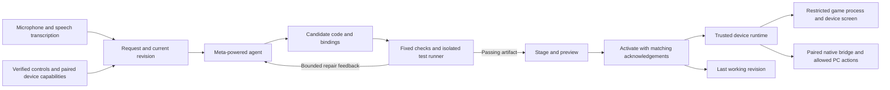

# Proposed Modulate architecture

Status: proposed full architecture, revised October 28, 2026. A [small voice-to-number implementation](number-prototype.md) now proves local transcription, Meta generation, a bounded AST interpreter and local checked activation on the PiTFT. It is not an arbitrary-Python sandbox or generated-game runtime; games, bindings and pairing remain proposed below.

## What the agent builds

Modulate has two initial jobs: generate a small original game for its own screen, and map its physical controls to actions on a paired computer. A Meta-powered agent receives the spoken request, current program, connected components, and permitted device actions. It proposes code and bindings, uses bounded verification tools, repairs failures within a fixed budget, and stages a passing revision for activation.

The first implementation should generate **application/game code inside a restricted runtime**, with a separate declarative control configuration. The fixed device service owns hardware drivers, rendering access, pairing, and recovery. This preserves the user's code-generation idea while keeping generated code out of firmware, OS drivers, and privileged host processes. Generating and flashing firmware remains a later research direction requiring its own verification and recovery design; it is not the initial deployment mechanism.

“Real time” is a product ambition for an interactive request-to-result experience, not an established latency guarantee. Model calls happen when creating or changing a program. Input handling, game updates, drawing, and volume commands run locally from the activated revision without an inference call per event or frame.

## Components and flow

| Component | Responsibility and boundary |
| --- | --- |
| Voice entry | Capture a deliberate request, transcribe it, and show the interpreted intent. “Hey Meta” is the proposed wake phrase for our interface; wake detection and transcription providers are unselected, and this is not a claim of an existing Meta assistant integration. |
| Trusted orchestration service | Keep provider credentials, call the Meta model, expose bounded tools, enforce generation budgets, and record provenance. It may run on the trusted host; the Pi is not assumed to run the model locally. |
| Verification service | Inspect the artifact and run a fixed harness in isolation. It reports failures; the model cannot replace the harness or mark itself passed. |
| Pi device service | Read the encoder/buttons, publish current capabilities, broker permitted runtime calls, render bounded output to the PiTFT, and manage activation and watchdog recovery. |
| Restricted game runtime | Execute generated game logic using a small versioned API for inputs, time, and drawing. It has no direct GPIO, network, filesystem, shell, process creation, or PC control access. The language and isolation mechanism remain to be selected and tested. |
| Pairing website and native PC bridge | Establish an authorized device relationship and expose tested OS actions, initially system volume. The bridge owns those actions; generated programs cannot submit shell commands or install new host code. |

The Mini PiTFT is the intended game display, so prove a readable, responsive small game on that screen early. Start with encoder steering and two buttons. A joystick is an envisioned module, not confirmed inventory. The Bluetooth speaker's microphone is untested. A host microphone can support a clearly labeled development path once permission and capture work; browser capture requires a secure context and user permission ([MDN](https://developer.mozilla.org/en-US/docs/Web/API/MediaDevices/getUserMedia)). Typed input is a diagnostic fallback, not evidence that the voice experience works.

## Bounded agent tools

The trusted orchestrator should expose only these operations, with schemas and enforced size/time limits:

1. **Inspect capabilities:** read verified component IDs, screen dimensions, supported runtime APIs, current revision, and paired targets with allowed actions. Omit credentials and unrelated host data.
2. **Generate candidate:** return a versioned package of source, declared requirements, bindings, labels, and a concise explanation. For a simple PC volume remap, a declarative binding is sufficient; do not generate unnecessary privileged code.
3. **Check candidate:** parse and validate the package, compile/type-check where applicable, then run the fixed isolated harness and report diagnostics. The orchestrator selects fixed commands and pinned dependencies; the model cannot request arbitrary build commands or downloads.
4. **Repair candidate:** submit a new artifact using bounded diagnostics. Set maximum attempts, elapsed time, output size, and provider usage before implementation. Exhaustion returns a visible failure and preserves the active revision.
5. **Stage and activate:** accept only the exact artifact that passed the required checks, against the current capability/session versions. Show what will change and activate within the user's authorized scope. A request must never grant a new PC permission by itself.

“Hey Meta, make Mario Kart” expresses the user's intended interaction. The proposed demonstration generates an original small kart racer using original or licensed assets and available controls; it does not claim to generate the Nintendo game or reproduce its assets. A follow-up such as “make steering less sensitive and add a lap counter” should cause a real generated change and new verification, not selection of a prerecorded preset.

## Versioned contract to define

| Object | Required information |
| --- | --- |
| Capability manifest | Protocol/runtime versions; manifest revision; stable control IDs and types; screen dimensions and drawing limits; tested inputs; paired target IDs, session epochs, action names, ranges, and permissions |
| Request | Request ID; transcript or typed text with its input mode; active revision; manifest revision; bounded conversation context; requested target when relevant |
| Program package | Schema version; revision and base revision; source or compiled artifact; source/artifact hashes; runtime requirements; declarative bindings; permitted target/action references; labels; asset provenance; unmet requirements |
| Verification report | Exact artifact/configuration hashes; harness and runtime versions; manifest/session versions; individual check results; resource usage; result and failure reasons |
| Activation acknowledgement | Request/revision ID; artifact hash; participant ID; activation epoch; success/failure; sufficient error detail for recovery |
| Input/action event | Active revision and epoch; control ID; event type/value; target/session when applicable; sequence number and bounded freshness information |

Game mode and PC volume mode share the package lifecycle and input broker. Validate identifiers, types, ranges, conflicting bindings, bounds, and version compatibility. Reject undeclared actions, arbitrary executable fields in configurations, and stale requests. A queued model response must not overwrite a newer revision or assume a device is still connected.

## Verification and containment

Treat all generated code, tests, and model explanations as untrusted. Model-written tests may supplement independent checks; they cannot provide the only evidence of correctness. Passing finite tests means those checks passed, not that the code is proven correct or safe.

Before execution, enforce the runtime API allowlist, package size limits, compatible capabilities, and available permissions. Run compilation and smoke tests in an isolated environment with no secrets, outbound network, unrestricted filesystem, or direct hardware access. The trusted runner may invoke only its fixed, pinned build/check tools; generated code may not create subprocesses, supply build commands, or replace those tools. Constrain memory, CPU, execution duration, output sizes, and event/drawing rates; the specific mechanism and limits must be selected and measured before generated code runs on a real device.

The fixed harness should test startup, representative input sequences, bounded updates/draw output, and handling of missing capabilities. It should deliberately exercise an infinite loop, resource exhaustion, forbidden access, and malformed bindings. Keep the same isolation boundary active during play, with a supervisor outside the generated process able to stop it and restore a known working revision. An ordinary process or syntax check alone does not establish containment.

Bind verification to the exact source, built artifact, bindings, manifest, and runtime versions. Any edit or relevant capability change invalidates the result and requires checking again. Preserve the fixed runtime and a recovery UI even when the generated program crashes. Never silently substitute cached output after a live generation failure.

## Website pairing and PC volume

The website is the linking and preview interface. Ordinary web media volume changes affect a media element ([MDN](https://developer.mozilla.org/en-US/docs/Web/API/HTMLMediaElement/volume)); they do not establish control of the computer's system volume. For that target, propose a small trusted native bridge using a tested API for one selected OS. Installing and authorizing that bridge is an explicit setup step. A browser-only demo must label its control as page audio volume.

Pair using an expiring, single-use linking code and confirm the intended controller and computer. Bind an authenticated, encrypted session to those identities and a minimal action allowlist. Keep pairing tokens out of model context, browser bundles, public logs, and generated artifacts; select transport and credential storage during implementation. The website must not expose an unauthenticated local command endpoint.

The bridge should advertise only actions it has actually tested and is authorized to perform, initially bounded volume adjustment and optional mute. Recheck target identity, permission, session epoch, active revision, event freshness, and range on every action. Deduplicate events so retries do not apply a volume delta twice. Reject cross-device and expired-session commands. Pairing revocation or disconnection immediately disables remote actions and updates the display; queued commands must not replay on reconnect. The game can remain usable locally if it has no remote dependencies.

## Activation and recovery

1. Validate the candidate against the current manifest and active base revision, then attach the matching verification report. A failed candidate leaves the current program usable.
2. Stage the program, bindings, and labels as one immutable revision. Determine its required participants: a local game needs the Pi runtime; a PC control mode also needs the selected native bridge. Unrelated paired devices are not activation prerequisites.
3. Gather matching readiness acknowledgements, briefly pause event dispatch, and coordinate activation of the same revision and epoch. Resume only when required participants acknowledge success. Ignore delayed acknowledgements for old requests and stop stale events from reaching the new program.
4. On timeout, failure, or partial activation, stop affected dispatch and restore the last acknowledged working package and labels. A disconnected PC target stays unavailable even after rollback; recovery must not reinstate revoked permissions.
5. Keep a watchdog and local recovery path independent of generated code. Rollback restores software/mapping state; it does not promise to undo host actions that already occurred, and it must never replay old input events.

Define and test the transition state machine before describing activation as atomic across the network. Verify that crashes, reconnects, duplicate messages, and stale acknowledgements cannot mix old labels with new behavior.

## Provider integration and evidence

Use one provider adapter behind a narrow interface. Baseten and Fireworks are candidate inference providers discussed in application drafts, not selected dependencies or confirmed account access. Verify a successful call, exact eligible Meta model identifier, authentication, supported response format, limits, timeout behavior, and cost controls before implementing the adapter. Do not assume native structured outputs or tool calling is available for a particular model. Transcription and wake detection are separate choices; they do not replace the Meta model's generation and repair role.

Provider references checked October 28: [Fireworks' Meta model catalog](https://fireworks.ai/models?providers=Meta) and [Baseten model serving](https://www.baseten.co/platform/model-management/). These establish advertised offerings, not our account access or a tested model choice.

Record sanitized model identity, request/revision IDs, artifact hashes, verification results, repair attempts, and device acknowledgements. Keep secrets, private transcripts, and raw microphone recordings out of public traces. Measure speech/transcription time, generation and verification time, activation time, input-to-display/action latency, and game frame behavior separately. Label live model, live device, simulator, typed-input fallback, and replay paths visibly.

## Implementation acceptance

- A spoken request produces new game code, passes independent checks, and runs on the device screen with physical controls; record which microphone and invocation method were used.
- An unfamiliar follow-up changes game behavior or bindings without manual source edits, with new verification evidence.
- The same knob changes system volume on an explicitly paired computer through the tested bridge; pairing revocation stops it.
- Malformed code, unsupported controls/actions, failed verification, sandbox violations, hangs, and lost connections preserve or recover a usable device state.
- Stale manifests, old acknowledgements, duplicate events, altered artifacts, and interrupted activation cannot activate unverified code or misdirect host actions.
- Exact provider/model access, voice capture and wake detection, runtime isolation, screen performance, host OS support, and pairing transport remain unresolved until demonstrated.
