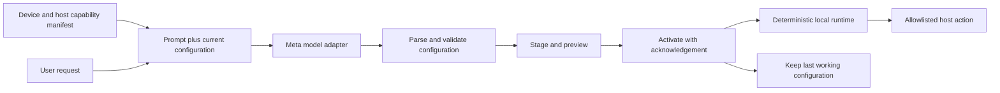

# Proposed architecture

Status: design only. The user confirmed a Raspberry Pi 5 (8 GB) and peripherals on October 28, 2026; see [hardware](hardware.md). Target that board, while transport, host stack, drivers, and model access still need verification. Avoid committing to purchases to make this plan work.

Proposed first deployment: a Pi service reads I2C controls and renders the SPI PiTFT; a local-network connection carries control events to a host demo application with prompt entry and preview. The Meta model can be called from a trusted service, keeping credentials outside browser code. Do not assume the Pi acts as a USB keyboard/MIDI peripheral or runs the chosen model locally. Start with the encoder and two external buttons; advertise sensors only after they pass bring-up.

## Control loop

The model plans a configuration when the user requests a change. Physical input events use that configuration locally without a model round trip. Host audio can provide the audible music result; an onboard speaker is not required for the first milestone.

## Contract to define first

| Object | Minimum information |
| --- | --- |
| Capability manifest | Device/protocol version; stable control IDs and input types; supported label/display outputs; supported host actions and ranges |
| User request | Requested behavior, current configuration, manifest version, and bounded recent revision context |
| Configuration | Schema version; revision ID; bindings to existing control IDs; allowlisted actions with bounded arguments; labels; concise explanation and unmet requirements |
| Activation acknowledgement | Revision ID, success/failure, and error detail sufficient to recover |
| Input event | Active revision, control ID, event type, value, and timestamp |

A music mode and a video-editing mode must use the same contract and execution path. Handwritten examples can be fixtures for validation; they must not masquerade as generated output.

## Validate and switch

1. Parse a bounded response. Reject unsupported versions, extra executable fields, invalid types, oversized values, and missing required fields.
2. Check every control and host action against the current manifest. Check parameter ranges and conflicting bindings. Ask for clarification when intent cannot be represented reliably.
3. Stage labels and bindings as one revision. Preview the mapping; require explicit activation for any consequential host action outside the agreed demo controls.
4. Activate only when host and device agree on the revision. Ignore stale acknowledgements and prevent input during a partially applied switch.
5. On timeout or disconnect, keep or restore the last acknowledged working revision. A rejected proposal must never destroy the current layout.

Exactly how staging works depends on the selected board and transport. Implement and test that protocol before calling it atomic or reliable.

## Model integration and evidence

Use one provider adapter behind a narrow request/response interface. Verify the exact Meta model identifier, authentication, response format, limits, timeout behavior, and cost controls from current provider documentation and a real successful call. Do not assume the provider offers schema-constrained generation; local validation is mandatory either way.

Record sanitized model identity, request/revision ID, timings, validation outcome, and device acknowledgement. Keep secrets and private prompts out of public traces. Track prompt-to-ready latency separately from physical-input-to-host-response latency.

## Implementation acceptance

- A supported request creates a valid configuration and a physical input produces the expected visible or audible effect.
- An unfamiliar follow-up request edits the configuration without manual code changes.
- Unsupported hardware requests and malformed model output leave the current mode working.
- Duplicate events, old acknowledgements, disconnects, and failed activation cannot mix old labels with new bindings.
- Simulator, live hardware, live inference, and replay states are visibly distinguishable.
