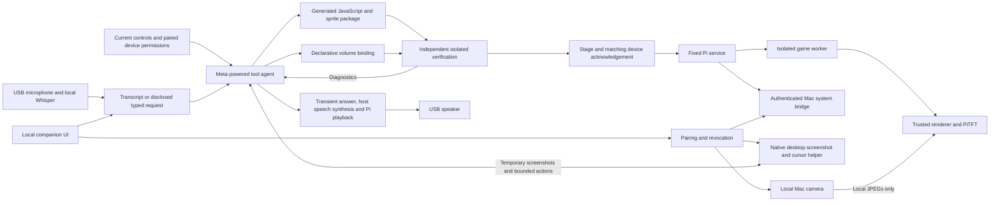

# Modulate architecture

Implementation snapshot, October 29, 2026. The prototype demonstrates typed generation of Pixel Kart Sprint and spoken generation of MODULATE: Self Assembly, physical controls, paired native Mac volume, PTT/hands-free refinements and UI rollback without model calls. The [runtime guide](product-runtime.md) records exact packages, timings and preceding audio failures. Repeated fault, revocation, noise and performance trials remain.

The browser computer-task and spoken-reply paths have a successful typed local-form trial and, after an earlier failure, a spoken Gmail latest-email readout. Visible Gmail independently confirmed the subject and the user heard the answer. Both native permissions report granted, and the authorized 120-minute session was enabled. Star Dash remained retained. This establishes those trials, not three verified subjects or broad reliability.

The user's later scope replaces separate Chrome grants with connected paired-Mac access to the primary desktop, camera and supported system settings. This extension is installed with the `12e26b7` camera deadlock repair; host status reports paired access enabled. Native camera and brightness get/set/restore probes succeeded. The user confirmed generated Funky Mirror Cam's live image/effects after repair; the subsequent native Calculator task completed and was independently verified.

## Data and control flow

The model generates application code for a fixed runtime, not new firmware, shell scripts, drivers or privileged host programs. The screen uses a 240×135 landscape canvas. After activation, input handling, game updates and rendering run locally without model calls in the frame loop. Computer control requires the paired host connection; it is not a browser media-volume change.

| Component | Current implementation and boundary |
| --- | --- |
| Voice | Native 48 kHz USB capture, PyAV resampling and local faster-whisper tiny.en. Installed repair uses Silero VAD bundled in pinned faster-whisper 1.2.1 instead of RMS silence detection, without a new model download. Wake probes follow 0.5 s non-speech; requests end after 3 s silence and discard at 25 s. Negative probes can retry after later speech, with results bound to their originating buffer. Pi tests passed; the user confirmed bare wake acknowledgement and a spoken request → audible reply → successful wake again trial. |
| Orchestration | Host-side model/tool loop; credentials remain on the host. Current provider adapters are Meta, Fireworks and local Ollama. No silent provider/preset fallback. |
| Verification | Fixed Python checks plus actual isolated worker execution. A model-written assertion cannot mark a package passed. |
| Game execution | Maintained QuickJS-NG binding in a persistent subprocess, bounded engine resources, parent wall timeout and platform OS restrictions. No generated host callbacks or I/O. |
| Rendering and controls | Trusted Pillow renderer and Pi hardware adapters. Generated code receives normalized input and returns bounded drawing commands. Advertised controls depend on successful device reads. |
| Companion | Loopback-served HTML/CSS/JavaScript, actual preview/events/checks, typed fallback, pairing, cancel, revoke and rollback. No external frontend dependency or browser microphone capture. |
| Native bridge | Fixed macOS volume scripts and native brightness helper, validated values, revocable hashed-token sessions, serialized actions and sequence rejection. Volume is demonstrated; a native brightness 46 → 47 → 46 trial restored the starting level. DisplayServices is a private macOS API and may vary across systems. |
| Computer tasks | New paired-Mac helper covers the primary display and app actions, with fresh screenshots and bounded input. Earlier Chrome-window trials succeeded; the expanded scope is installed; a live native Calculator task completed and was independently verified. |
| Live camera | New local AVFoundation capture produces 240×135 JPEGs for the trusted Pi renderer, combined with generated drawing/controls. A native probe succeeded; after a transport deadlock repair, the user confirmed the generated live camera/effects on the Pi. No camera pixels enter model requests or game inputs. |
| Spoken replies | Installed host-side ElevenLabs Flash v2.5/Roger synthesis and transient 24 kHz mono PCM delivery over enrolled TLS to Pi playback. Single-worker cancellation/replacement, microphone pause and physical interruption remain. The user confirmed the new natural voice and good volume at 75%; device telemetry reports delivered without error. |

The joystick at `0x20` has user-confirmed steering, with X reaching −1 and 1 in live samples. Encoder deltas at `0x36` were subsequently captured while changing native Mac volume; the user confirmed direction. Green `0x6E` and red `0x6F` buttons independently reported firmware 259 after power cycling and worked in the game. Green OR PiTFT A supplies logical `button_a`; red OR PiTFT B supplies `button_b`. Pairing/PTT use physical PiTFT buttons only. Bluetooth microphone, gesture, IMU and hot swapping are not current capabilities.

## Agent decisions and tools

The model chooses its tool order and sensible reversible defaults; it does not merely select a preset or repeatedly ask the user to choose technical details. New-app requests replace the current app after checks; edits refine it. It inspects current capabilities before declaring something unsupported. Package tools are `inspect_capabilities`, `read_runtime_api`, `read_current_package`, `write_package`, `test_package`, `preview_package`, `activate_package`, `delegate_task` and `ask_user`. Trusted `computer_observe`, `computer_act`, `system_control` and metadata-only `camera_control`/`computer_audio` provide paired-Mac actions. `speaker_control` adjusts the Pi output; it is a different target from Mac system volume.

Installed `9b172e8` adds model-selected runtime skills: `computer-use`, `device-apps`, `games` and `hardware-controls`. The model sees their short catalog descriptions and chooses `load_skill` before relevant work, then selects tools for the observed task. There is no fixed keyword router or prescribed call sequence. The bounded loader reads only bundled paths; loading instructions grants no additional authority. Non-game visual apps use the existing package runtime without being forced into a game design.

Recent context contains up to 12 turns eligible for eight hours, including outcome (`completed`, `failed`, `cancelled`, `awaiting_answer`), selected skills and bounded observed action results. Before/after values are retained when returned by the trusted tool; a failed overall request may still have applied a recorded action. The model uses this reference data for “again,” “louder” or “undo,” with the explicit current request and live state taking precedence. Remembered values are not new permission. Non-private records persist in `recent-context.json` in the ignored private state directory with mode `0600`. Expired records are excluded on read; the file is rewritten on the next save or clear.

Library knob direction is a trusted UI preference, separate from generated app
bindings. `app_library(set_preferences, encoder_direction=forward|reversed)` saves
an absolute value atomically in private `library/preferences.json`; legacy state
defaults forward. Current preferences enter intent context, and saved before/after
values support undo. The Pi applies the sign only to library encoder input, then
adds joystick input normally. A changed menu version invalidates stale actions
and requires fresh button input. See [the library contract](app-library.md).

Computer-task details remain RAM-only and available for two minutes. Automatic context shows a redacted marker; recovering details with `read_recent_context(include_private:true)` requires current computer authorization and enters private mode, preventing package writing/delegation. No screenshots, raw audio or arbitrary tool payloads enter memory. Studio's **Forget recent context**, after current work finishes or is cancelled, clears remembered turns and pending clarification. Revocation and new pairing also clear context; a generation check prevents older jobs from repopulating it.

Pi volume uses `speaker_control(get|set|delta|mute)` and fixed PulseAudio operations on the selected sink shared by TTS and streamed Mac audio. Set accepts 0–100; delta accepts nonzero ±1–10 percentage points and clamps at the limits; mute takes a boolean. Startup only reads the existing level. An expiring command is bound to device session, sink, epoch and revision; the worker consumes it once and returns actual before/after readback. The host reports success only on the matching acknowledgement, with replay, withdrawal and disconnect checks. Timeout leaves the outcome unknown rather than inventing success or retrying a possible write. Immediate Pi volume does not add a new generated binding type.

This deployment ran **688 host tests with 11 skips**; all **164 focused Pi tests passed in 2.693 s**, and the pinned archive SHA256 was checked. These are implementation/behavior tests, not measured intent accuracy or a live ambiguous-follow-up result.

Accepted work receives a persisted `job_id` and increasing `job_sequence` before the orchestrator's `request_id` exists. The UI's `agent` and heartbeat's `agent_state` carry the same running/status/phase/title/tool/role fields. Trusted events produce queued, planning, coding, checking, previewing and activating stages; terminal states are ready, error or cancelled. Cancellation may retain `running=true` while a provider call finishes. The Pi pauses gameplay/control dispatch behind the processing card, retaining the old runtime. Wake listening remains enabled for local cancellation while ordinary requests are suppressed. Matching completion or a newer job sequence resolves the latch; stale updates cannot dismiss it. Disconnects show status unknown, and interrupted host restarts mark the persisted job failed. No percentage is fabricated.

After local recognition, microphone requests enter a separate three-second transcript-review window before any model call. Studio's Edit action pauses that deadline until Send now; Discard or an explicit local “Hey Meta, cancel build” discards the draft. Cancellation during generation targets the accepted job ID and does not generate a new model request. It prevents later actions but does not undo an already committed activation or volume change.

The orchestrator uses `ask_user` for a short clarification, ending its current turn without other tool actions in that response. The implemented conversation flow keeps the first ambient request wake-gated. After a question's speech and cooldown, one direct answer may begin within 20 seconds without repeating the wake phrase; the exact host question ID expires after 120 seconds. Repeated heartbeats never extend or reopen that listening grant. The host includes the original goal, question and earlier replies, with at most four questions and one user-answered operational recovery turn. Cancellation, mute, busy state and expiry invalidate direct-answer capture. Studio's Keep current app action dismisses the question.

Local filtering rejects only clear fillers and exact unfinished fragments, preserving short answers such as “blue,” “slower” and “yes.” The model is instructed to explain observed failures, ask only when information or repaired access can help, and stop when the requested capability is unavailable. A spoken “yes” answers its concrete question; it grants no unrelated consequential authority. Existing explicit authorization for the actual action still applies. Other ambiguity belongs to the model; no measured intent-confidence percentage is claimed. These changes preserve the fixed package/runtime boundary. A live space-joke question → “yes” without wake → spoken joke trial succeeded in two Meta calls; the user confirmed the direct answer was understood, and the device returned to wake listening. This is one demonstrated exchange, not a reliability benchmark.

Delegation can invoke coder, artist or reviewer roles. At most two delegations are permitted; each specialist has at most five turns and cannot activate or delegate again. The orchestrator can use the remaining shared budget; all roles share a maximum of eighteen model calls per request and one persisted spending ledger. A text-only model answer does not force tool use or activation. Cancellation blocks subsequent actions; an already dispatched provider request may still incur a charge.

The host reserves conservative request costs before dispatch and settles known usage afterward. Unknown charges remain reserved; corrupted accounting or reported usage above reservation halts further calls. This bounds this service's planned usage, not external account charges. The first live `muse-spark-1.3` game request used 11 calls, recovered from a malformed package-write tool call through a model-chosen coder delegation, and reached activation in about 49 seconds. The adapter's primary documentation references are recorded in [`agent_provider.py`](../modulate/agent_provider.py).

The latest update allows at most two repairs of a malformed model response per request, within the existing shared turn/call/budget limits. No action from a rejected response is executed. Validated billing can settle that call even if its response is malformed; missing or unknown usage leaves the full reservation held. This does not silently change providers or reset the budget.

## Hardware diagnosis and guided setup

The fifth bundled skill, `hardware-debugger`, handles missing modules, wiring and device faults separately from `hardware-controls` settings/mappings. The root agent chooses `hardware_debug` inspect/scan/reinitialize or a persistent guided Qwiic-button repair. Inspection adds driver status, bus addresses, checked button identity and voice/speaker/display/connection metadata. Unknown hardware remains unidentified; an ACK cannot count boards sharing one address.

The host saves setup phases in private `hardware-repair.json`; physical-step confirmations are direct user input, bound to the current workflow step, Pi session and boot, and expire after 120 seconds. Studio retains the instructions while the Pi is offline. The Pi worker serializes I2C operations with input reads and accepts only fixed diagnostic commands or the supported factory-button address change. It durably consumes each mutation ID before the write, checks identity/firmware and singleton-bus evidence, and never replays an uncertain write. Both isolated power-cycle readback and reconnected-bus verification precede completion. A boot change is evidence of reboot, not proof of physical isolation or unplugging.

Hardware command delivery and withdrawal run on the network thread; cached capability reads do not block on the I2C lock. Missing required controls suspend the saved app without replacing its active/previous records. Once controls return, the app is reverified before resuming; malformed code and actual runtime failures still use the established rollback path. New activation is rejected while suspended. See [hardware debugger procedure and manufacturer sources](hardware-debugger.md) for supported firmware, physical instructions, scan limits and the distinction between a uniquely addressed third button and a new logical game input.

## Connection setup before computer access

`SetupScreen` runs locally in the maintained Pi process, including when a strict enrollment file is unavailable. `PendingCompanion` periodically retries the original private-file/HTTPS/certificate-pinning validation; it does not bypass it or accept an arbitrary public host. Setup is a temporary display overlay, below active voice/build/pairing/repair interactions, with boot-local dismissal and no generated package replacement.

The host's `connection_setup(status|show|start_pairing|create_browser_code)` tool is orchestrator-only and bundled in the `connection-setup` skill. It reads safe status or prepares an offer; it does not grant native access. `/device/setup` is a fixed enrolled-device endpoint for the same physical screen actions. The heartbeat carries safe `setup_status` plus an optional short-lived `setup` offer. Browser codes occur only in that enrolled-device offer; model/tool results and normal state omit them. Native pairing continues through its separate fresh-press confirmation. A code is invalidated when claimed/replaced/revoked/expired, and stale companion responses cannot keep a setup code visible offline.

The model lives on the Mac companion. Without that connection the Pi provides deterministic guidance, not inference. OS/Wi-Fi bootstrap, a companion installer, enrollment provisioning and native macOS permission grants still require user setup; this feature does not imply autonomous installation.

## Packages and verification

A game package has `{kind, title, code, assets, controls}` and may declare `camera:{target:paired_session_id}`. Its JavaScript implements `init`, `update` and `draw`; original indexed-palette sprites remain required. One bounded `camera` drawing command can select mirroring, pixelation and a palette; generated geometry, sprites and controls supply procedural overlays. The trusted renderer supplies live pixels after game execution. The camera target must match the actual pairing, and existing exact-hash verification/activation still applies. Candidate previews use a camera placeholder, not proof of live capture. A control package has `{kind, title, target, bindings}`; its encoder `volume.delta` or `brightness.delta` scale is a nonzero integer from −10 to 10 and must be advertised by the paired host. [Exact limits](product-runtime.md#generated-package-and-execution-contract).

Candidate identity is a hash of the package. The agent's verification record includes that candidate ID and a hash of the capability manifest. Activation rejects an edited candidate/report, changed manifest, missing requested control, stale active base or revoked target. Passing verification does not guarantee meaningful game design or every future input path.

The fixed game harness checks startup, 48 representative updates, valid bounded state/drawing and use of a supplied sprite. Separate fixed hostile probes exercise CPU, memory, state and command limits. Workers receive no secrets, use Python isolated mode and a minimal environment, and deny file opening, network and process creation at the OS boundary. Startup denial probes run before generated code. Linux uses an explicit seccomp denial list; macOS uses its sandbox API. This remains a native interpreter process, not VM-grade isolation; an engine/kernel vulnerability is a residual risk.

## Pairing, transport and host actions

The UI binds to loopback. Mutations require matching origin, a SameSite session cookie and CSRF token. The controller uses a separate TLS listener with pinned local certificate, enrollment bearer key and exact peer IP allowlist. Enrollment is a trusted manual setup step; the private enrollment record is not supplied to the model or browser.

The studio renders against its real API; pinned TLS carried checked game/control activations. Encoder events changed actual paired Mac system volume, confirmed through independent native reads.

Pairing uses a two-minute single-use code delivered over the enrolled connection, confirmed with PiTFT A or declined with B; the CLI option remains a disclosed fallback. The bridge hashes credentials, limits attempts and expires sessions after eight hours. Under the user's new scope, a connected session also authorizes desktop actions, camera and supported system settings without another Chrome grant. Native permissions, stop/pause, revoke and disconnect checks remain. Generated packages receive session identifiers and action descriptions, never tokens. Sequence checks prevent replay; uncertain native failures consume their sequence because an effect may already have occurred.

The bridge uses fixed `osascript` programs with separate validated arguments; the model cannot supply script text. Native volume changes were demonstrated across observed values 0–100, with scale +2 refined through speech to +1, −1 and then −10. The bridge also exposes bounded volume get/set/mute and advertised brightness get/set/delta; generated encoder mappings support either volume or brightness delta. Revocation and broader reconnect/fault behavior remain separate acceptance work.

## Computer tasks and spoken replies

The user explicitly requested actual computer interaction, including reading email through the browser, instead of a Gmail API. This path uses an independently implemented Python helper, not generated application code. Installed computer-use plugin metadata was inspected, but no reusable `SKILL.md` source was present; no Codex service, token or proprietary runtime was copied.

The earlier browser trials used a separate Chrome-window grant. The user's newer scope authorizes requested computer work through the connected eight-hour paired-Mac session, superseding that grant. The new helper observes the primary display, with native Screen Recording/Accessibility still required. Each observation is single-use, expires after 30 seconds and maps the normalized 0–1000 grid to the exact captured display. Authority, geometry and cancellation are rechecked before actions. Screenshots remain transient JPEGs with a 1280-pixel edge and 350 KB limit; each task permits at most 100 actions. Visible screenshots may include other windows/overlays. The expanded path is installed; live generated camera effects were user-confirmed after repair. A live Meta task operated native Calculator and produced 2+2 = 4, independently verified, with the camera app retained.

App switching is now intentional through a bundle-ID launch action and fresh observation; the former single-Chrome-window focus policy no longer defines the scope. Stop/pause, revocation, pairing expiry and disconnect prevent further actions. Failure feedback stays transient and spoken. A dispatched action may already have taken effect.

Actions include click/double/right-click, drag, bounded scroll, Unicode text with paragraphs/tabs, key chords and app launch. Routine requested app/system work needs no additional permission question. Sending, deletion, purchases, publishing or permission changes require confirmation only when that concrete action was not already authorized. Terminal/developer tools may be used when necessary for the user's requested task; instructions in pages/email never become shell authority. Device-app creation stays inside package tools and cannot rewrite Modulate's core. Credentials remain user-entered. These semantic instructions are not a hard application sandbox; pointer-corner failsafe and cancellation remain.

Once computer observation/action begins, private task mode permits computer actions, bounded system settings, metadata-only camera control, capability inspection and clarification, but no package writing or delegation. Requested computer-task screenshots go transiently to Meta vision; derived answers stay out of durable activity details and expire from the response/speech path after two minutes. Camera frames follow a separate local path outside model requests, generated code and disk. A desktop screenshot may nevertheless include a camera preview visible on screen. Local non-retention does not change provider retention for computer screenshots or speech.

The new speech path synthesizes on the host through ElevenLabs `eleven_flash_v2_5` with the selected Roger voice. Its scoped key stays on the host, with a seven-day expiry and 5,000-credit provider limit. A separate durable 5,000-input-character ceiling reserves before dispatch and retains uncertain reservations; these characters are not provider credits or dollars. Each reply is at most 1,200 characters and 90 seconds of 24 kHz mono S16LE PCM. One synthesis worker keeps only the newest pending reply; cancellation, expiry or replacement discards late results. Audio remains in memory and is fetched through the enrolled, authenticated TLS device endpoint with size/hash verification. A queue acknowledgement clears delivery metadata while keeping audio fetchable until expiry; it is not proof of audibility. ElevenLabs failure yields a generic visible error and no local-voice fallback. The provider's default retention applies; local non-retention is not zero provider retention.

The Pi pipes PCM to its selected output and pauses the microphone while queued, fetching, playing, stopping and briefly afterward. Physical PiTFT B stops speech; the two-button PTT chord can interrupt to listen. Output recovery checks every five seconds, with a two-second discovery timeout, and requires the same sink. Earlier eSpeak replies were heard through USB Jieli at 40%. At the new 75% setting, the user confirmed ElevenLabs sounded natural and the volume was good; device telemetry reported `elevenlabs/paplay` delivered without error. Legacy local synthesis remains an explicit configuration, never a hidden recovery from an ElevenLabs failure.

Third-party components: [PyAutoGUI](https://pyautogui.readthedocs.io/en/latest/) supplies cursor/keyboard input, [MSS](https://python-mss.readthedocs.io/stable/) supplies screen capture, and [PyObjC](https://pyobjc.readthedocs.io/en/latest/) exposes native permissions/window metadata. Vision follows [Meta's vision-input](https://dev.meta.ai/docs/cookbook/vision-input) and [coordinate-system](https://dev.meta.ai/docs/image-understanding#coordinate-system) documentation. New speech uses [ElevenLabs streaming TTS](https://elevenlabs.io/docs/api-reference/text-to-speech/stream) and its [PCM format](https://elevenlabs.io/docs/overview/capabilities/text-to-speech); earlier local speech uses [eSpeak NG](https://github.com/espeak-ng/espeak-ng/blob/master/docs/guide.md). [paplay](https://manpages.debian.org/bookworm/pulseaudio-utils/paplay.1.en.html) supplies playback. These dependencies are reused; the integration, scope checks and product loop are project code. Versions are pinned in `requirements-computer.txt`; Linux speech binaries are OS packages.

## Activation and recovery

The host stages an exact package with a unique activation ID, package revision and base revision. Matching device readiness moves the host to commit; matching activation acknowledgement permits persistence of the active record and previous package. Mismatched or stale acknowledgements are ignored. Cancellation, timeout, loss of connection and device errors abort the pending activation.

The product's staging, watchdog and rollback require broader fault testing before claiming atomic behavior across every network failure. A successful driver call is a software acknowledgement, not optical display readback. Retain the last working application during generation, paused behind the processing card. Recovery restores software state and must not replay old physical events or revive a revoked host permission. It cannot undo an already applied volume adjustment.

## Acceptance evidence still needed

The later [Modulate Connect extension](connect.md) adds a public dashboard through a dedicated authenticated gateway on loopback port 8789. The original Studio and Pi listeners retain their existing boundaries. Browser codes and hashed expiring sessions are maintained by the companion; Vercel carries only HttpOnly browser session cookies and forwards fixed operations. Shared device permission switches gate native tools, microphone requests and continuing control mappings, and survive restart even if the public gateway is disabled. They do not grant macOS permissions or make a phone's own OS controllable.

Provider keys may now remain in production Vercel secrets, reached by a separate companion-only credential. The agent and durable spending/character ledgers still run on the Mac, with their existing reservations and caps. The default camera path stays Mac-to-Pi; a separate explicit browser-preview permission allows those frames through Vercel and the outbound connection. This supersedes earlier descriptions that camera pixels always remain local. Computer-task screenshots and speech keep their previously documented provider destinations.

- Repeat the successful typed/spoken game activations with consecutive trials and additional gameplay paths; these individual runs are not a reliability guarantee.
- Repeat spoken refinements with unfamiliar requests and measured capture/transcription timing; keep each run’s input mode and measured interval explicit.
- Extend the demonstrated paired native-volume action with explicit revoke/disconnect trials and confirm that stale events cannot affect the host.
- Extend the successful UI rollback −10 → −1 → −10 (zero model calls) with failure, timeout and restart trials. Software acknowledgements are not optical display readback.
- Test wake/noise and false triggers after the successful hands-free trials, disclosing the transcription gap and initial stream-overflow failures. Keep host preview, fixtures, typed fallback and replay distinct from live evidence.
- Extend the successful spoken latest-email trial with repeated focus/window-change, cancellation and revocation checks. Preserve the earlier failure; do not infer three subjects or general reliability. The $50 ceiling retains existing usage and unknown-cost holds.
- Extend user-heard replies with physical interruption and microphone isolation checks. The Pi passed 92 earlier speaker/device tests plus 46 final device checks; Star Dash remains retained. Local validation ran 417 tests with three Mac PyAV skips.

## Mac system-audio capture and routing

`SystemAudio` owns an explicitly started ScreenCaptureKit worker and registers only audio output. It requests 48 kHz stereo, disables microphone capture and excludes the current process's audio. Native bounded linear PCM is converted to interleaved S16LE. Five 100 ms blocks plus a partial block remain in memory; `chunk(after, session, timeout<=0.5)` returns consecutive blocks up to 200 ms. A stale cursor, changed session or `after=None` returns recent audio with `reset:true`; samples at least one second old are discarded. Stop/error clears buffers, and generation/cancellation checks reject late callbacks. Audio is never a model input, generated-code input, recording file or log payload.

Capture is a mirror and does not change Mac output. `MacAudioRoute` is a separate trusted mute lease: its caller starts it only after Pi playback acknowledgement and stops it on playback end/failure, disconnect or revoke. Fixed public CoreAudio properties identify the current output by object ID plus private device UID and write only its mute flag. Volume and output selection stay untouched. Stop restores only when the same default output remains selected and mute still matches the owned write; a pre-existing mute or observed external unmute is preserved. Restore failure retains the lease for retry and reports a generic error. The lease is in memory, so a force-killed host can leave the Mac muted; this is not a virtual output driver or a crash-safe OS routing service.

The host passed native capture, muted capture and mute/restore probes; physical Pi playback remains separate evidence. APIs and reused bindings: Apple's [ScreenCaptureKit sample](https://developer.apple.com/documentation/screencapturekit/capturing-screen-content-in-macos), [current-process exclusion](https://developer.apple.com/documentation/screencapturekit/scstreamconfiguration/excludescurrentprocessaudio), [CoreAudio mute property](https://developer.apple.com/documentation/coreaudio/kaudiodevicepropertymute), and [PyObjC ScreenCaptureKit](https://pyobjc.readthedocs.io/en/latest/apinotes/ScreenCaptureKit.html). Current-process exclusion does not prevent acoustic feedback from the Pi speaker; microphone/playback arbitration requires its own physical validation.

The installed `computer_audio` tool uses the existing enrolled TLS origin and bearer/peer checks. A separate receiver long-polls bounded audio packets, leaving heartbeats responsive. Its cursor binds to the current stream; discontinuity, resume and overruns flush playback to the live edge. Pair expiry, pause, revoke, disconnect or playback failure stop capture and release the mute lease. PiTFT B latches a stopped stream ID across repeated offers, while speech/request ducking only pauses playback and drains incoming audio. A separate playback flag enables periodic local wake probes without disabling the microphone; this is not acoustic echo cancellation. A live typed start and spoken stop were user-confirmed on the actual speaker/Mac. [Evidence](evidence/computer-audio.json).

## Preloaded device enrollment

The customer setup contract assumes the device software is factory-loaded.
Customer agents operate on the Mac; Raspberry Pi Connect, SSH credentials,
developer accounts and historical private addresses are not setup dependencies.
The device must already have a working IPv4 or IPv6 network route to the Mac.
Wi-Fi provisioning and a distributable OS image are separate work, not provided
by the downloadable skill. Same Wi-Fi alone is insufficient on isolated guest
networks; the setup screen prefers a usable IPv6 address when available.

On an unenrolled boot only, the trusted device service starts HTTPS port 8790.
Its own local EC certificate is pinned by the first 20 hexadecimal SHA-256
characters read from the physical display (80-bit out-of-band identity). A fresh
small-A press opens an eight-digit setup code for five minutes with five global
invalid attempts. The Mac helper verifies that pin before sending HTTP bytes;
it never disables checks on the normal companion transport. Customer setup
values are entered in a loopback-only, origin/CSRF-protected Mac form on 8791.

The device accepts only the HTTPS companion origin on 8788, its public
certificate and device bearer credential. The literal source peer must match
the origin and the certificate IP SAN. The bounded payload is held in memory
until a new physical A press confirms the rendered request; a held button,
PTT chord or stale proposal cannot authorize it. Commit uses exclusive atomic
file creation, mode 600 and a fixed generated public-certificate filename;
existing enrollment, saved apps and ledgers are preserved. Authenticated
receipts identify the exact proposal, and the Mac does not report completion
from an unrelated receipt. There is no command, provider-key, generated-code
or arbitrary-file transfer API. Certificates use existing Python TLS and
[OpenSSL X.509 tooling](https://docs.openssl.org/3.0/man1/openssl-x509/).

The device reloads enrollment through PendingCompanion; the existing separate
native Mac pairing and browser-session protocols still apply. A paired boot
does not open this bootstrap listener. A legacy image without this service
requires a factory update, not an invented customer remote-shell fallback.

### Local comparison-code visibility and enrollment recovery

Pending native Mac pairing has a separate local-only `GET /api/pairing` route
protected by the existing Studio cookie, CSRF token, Host/Origin checks and
cross-site request checks. Reading it never creates or rotates a code. The
ordinary state, capabilities, remote gateway and model context omit this code.
Studio polls it alongside state so gadget-initiated requests are visible before
the human compares both screens and approves. Saved pairing and fresh online
telemetry are separate indicators.

The enrollment helper exposes bounded stage/action/error enums and monotonic
updates so stale responses cannot reopen a completed step. Device error reasons
are allowlisted; legacy ambiguous errors are not diagnosed as expiry. Identity
mismatch locations are hints for physical inspection, never replacement pins.
The 0.3.0 setup probe prints only allowlisted status fields from fixed loopback
endpoints, with redirects/proxies disabled and bounded response sizes.
