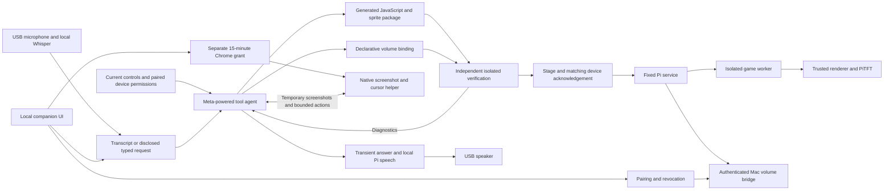

# Modulate architecture

Implementation snapshot, October 28, 2026. The prototype demonstrates typed generation of Pixel Kart Sprint and spoken generation of MODULATE: Self Assembly, physical controls, paired native Mac volume, PTT/hands-free refinements and UI rollback without model calls. The [runtime guide](product-runtime.md) records exact packages, timings and preceding audio failures. Repeated fault, revocation, noise and performance trials remain.

The user-requested browser computer-task and spoken-reply paths are implemented separately. The user confirmed standalone USB speech and authorized native Chrome/screenshot-to-Meta testing. Both required permissions report granted; the full model-driven capture/cursor/spoken-reply loop is not yet validated.

## Data and control flow

The model generates application code for a fixed runtime, not new firmware, shell scripts, drivers or privileged host programs. The screen uses a 240×135 landscape canvas. After activation, input handling, game updates and rendering run locally without model calls in the frame loop. Computer control requires the paired host connection; it is not a browser media-volume change.

| Component | Current implementation and boundary |
| --- | --- |
| Voice | Native 48 kHz USB capture, PyAV resampling and local faster-whisper tiny.en. A wake-only check begins after 0.5 seconds of silence while capture continues; full wake/PTT requests end after three seconds of silence. Audio at 25 seconds is discarded. Ambient recognition stays visually passive; busy listening accepts local cancellation only. Final recognition can still pause capture; room-noise reliability remains unmeasured. |
| Orchestration | Host-side model/tool loop; credentials remain on the host. Current provider adapters are Meta, Fireworks and local Ollama. No silent provider/preset fallback. |
| Verification | Fixed Python checks plus actual isolated worker execution. A model-written assertion cannot mark a package passed. |
| Game execution | Maintained QuickJS-NG binding in a persistent subprocess, bounded engine resources, parent wall timeout and platform OS restrictions. No generated host callbacks or I/O. |
| Rendering and controls | Trusted Pillow renderer and Pi hardware adapters. Generated code receives normalized input and returns bounded drawing commands. Advertised controls depend on successful device reads. |
| Companion | Loopback-served HTML/CSS/JavaScript, actual preview/events/checks, typed fallback, pairing, cancel, revoke and rollback. No external frontend dependency or browser microphone capture. |
| Native bridge | Fixed macOS volume scripts with validated values, revocable hashed-token sessions, serialized actions and sequence rejection. Other operating systems report unsupported. |
| Computer tasks | Independent native Python helper for one granted Chrome window, with fresh screenshots and bounded mouse/keyboard actions. Native permissions report granted; actual Meta-driven operation awaits validation. |
| Spoken replies | Local eSpeak NG synthesis piped to the selected USB output via paplay; transient text/audio, microphone pause and physical interruption. Standalone speech is user-confirmed audible; integrated replies remain to test. |

The joystick at `0x20` has user-confirmed steering, with X reaching −1 and 1 in live samples. Encoder deltas at `0x36` were subsequently captured while changing native Mac volume; the user confirmed direction. Green `0x6E` and red `0x6F` buttons independently reported firmware 259 after power cycling and worked in the game. Green OR PiTFT A supplies logical `button_a`; red OR PiTFT B supplies `button_b`. Pairing/PTT use physical PiTFT buttons only. Bluetooth microphone, gesture, IMU and hot swapping are not current capabilities.

## Agent decisions and tools

The model chooses its tool order; there is no fixed sequence that merely selects a preset. It can inspect capabilities, read the runtime contract/current package, write a complete package, test it, inspect failures, preview, and activate. Package tools are `inspect_capabilities`, `read_runtime_api`, `read_current_package`, `write_package`, `test_package`, `preview_package`, `activate_package`, `delegate_task` and `ask_user`. Separate `computer_observe` and `computer_act` tools support user-requested computer work.

Accepted work receives a persisted `job_id` and increasing `job_sequence` before the orchestrator's `request_id` exists. The UI's `agent` and heartbeat's `agent_state` carry the same running/status/phase/title/tool/role fields. Trusted events produce queued, planning, coding, checking, previewing and activating stages; terminal states are ready, error or cancelled. Cancellation may retain `running=true` while a provider call finishes. The Pi pauses gameplay/control dispatch behind the processing card, retaining the old runtime. Wake listening remains enabled for local cancellation while ordinary requests are suppressed. Matching completion or a newer job sequence resolves the latch; stale updates cannot dismiss it. Disconnects show status unknown, and interrupted host restarts mark the persisted job failed. No percentage is fabricated.

After local recognition, microphone requests enter a separate three-second transcript-review window before any model call. Studio's Edit action pauses that deadline until Send now; Discard or an explicit local “Hey Meta, cancel build” discards the draft. Cancellation during generation targets the accepted job ID and does not generate a new model request. It prevents later actions but does not undo an already committed activation or volume change.

The orchestrator can use `ask_user` for one short clarification, ending its current turn without other tool actions in that response. The question appears on the Pi and in Studio; the next request includes the original request, question and reply, retaining context across repeated questions. Studio's Keep current app action or local cancellation dismisses the question. Local filtering rejects only clear fillers and exact unfinished fragments, preserving short answers such as “blue,” “slower” and “yes.” Other ambiguity belongs to the model; no measured recognition or intent-confidence percentage is claimed. This changes the request flow, not the fixed package, hardware or privileged host-action boundary.

Delegation can invoke coder, artist or reviewer roles. At most two delegations are permitted; each specialist has at most five turns and cannot activate or delegate again. The orchestrator has at most twelve turns; all roles share a maximum of eighteen model calls per request and one persisted spending ledger. A text-only model answer does not force tool use or activation. Cancellation blocks subsequent actions; an already dispatched provider request may still incur a charge.

The host reserves conservative request costs before dispatch and settles known usage afterward. Unknown charges remain reserved; corrupted accounting or reported usage above reservation halts further calls. This bounds this service's planned usage, not external account charges. The first live `muse-spark-1.3` game request used 11 calls, recovered from a malformed package-write tool call through a model-chosen coder delegation, and reached activation in about 49 seconds. The adapter's primary documentation references are recorded in [`agent_provider.py`](../modulate/agent_provider.py).

## Packages and verification

A game package has `{kind, title, code, assets, controls}`. Its JavaScript implements `init`, `update` and `draw`; generated indexed-palette sprites are required. The maintained limits are in the [runtime guide](product-runtime.md#generated-package-and-execution-contract). A control package has `{kind, title, target, bindings}`. The first supported binding is an available encoder mapped to `volume.delta` on the currently paired session, with a nonzero integer scale from −10 to 10. The host bounds the resulting delta again.

Candidate identity is a hash of the package. The agent's verification record includes that candidate ID and a hash of the capability manifest. Activation rejects an edited candidate/report, changed manifest, missing requested control, stale active base or revoked target. Passing verification does not guarantee meaningful game design or every future input path.

The fixed game harness checks startup, 48 representative updates, valid bounded state/drawing and use of a supplied sprite. Separate fixed hostile probes exercise CPU, memory, state and command limits. Workers receive no secrets, use Python isolated mode and a minimal environment, and deny file opening, network and process creation at the OS boundary. Startup denial probes run before generated code. Linux uses an explicit seccomp denial list; macOS uses its sandbox API. This remains a native interpreter process, not VM-grade isolation; an engine/kernel vulnerability is a residual risk.

## Pairing, transport and host actions

The UI binds to loopback. Mutations require matching origin, a SameSite session cookie and CSRF token. The controller uses a separate TLS listener with pinned local certificate, enrollment bearer key and exact peer IP allowlist. Enrollment is a trusted manual setup step; the private enrollment record is not supplied to the model or browser.

The studio renders against its real API; pinned TLS carried checked game/control activations. Encoder events changed actual paired Mac system volume, confirmed through independent native reads.

Pairing uses a two-minute single-use code delivered over the enrolled connection. The normal flow asks the user to match the Mac/Pi code and press PiTFT A to allow or B to decline; the CLI code option is a disclosed development fallback. The bridge records hashed credentials, limits attempts, and grants eight-hour volume-only sessions. Generated packages receive a session identifier and action descriptions, not the token. Revocation removes sessions and pending codes. Sequence checks and serialized state updates prevent an accepted volume delta being replayed; an uncertain native timeout consumes its sequence because an OS effect may already have occurred.

The bridge uses fixed `osascript` programs with separate validated arguments; the model cannot supply script text. Native volume changes were demonstrated across observed values 0–100, with scale +2 refined through speech to +1, −1 and then −10. The bridge also implements get/mute, while current generated mappings use volume delta. Revocation and broader reconnect/fault behavior remain separate acceptance work.

## Computer tasks and spoken replies

The user explicitly requested actual computer interaction, including reading email through the browser, instead of a Gmail API. This path uses an independently implemented Python helper, not generated application code. Installed computer-use plugin metadata was inspected, but no reusable `SKILL.md` source was present; no Codex service, token or proprietary runtime was copied.

Studio offers a separate, default-off 15-minute computer grant. Enabling requires native Screen Recording and Accessibility permissions and a frontmost Chrome window wholly on the primary display. The grant fixes that window's identity and geometry. The helper rechecks permissions, focus, scope, expiry and cancellation before capture/action. Each observation is single-use, expires after 30 seconds and maps resized coordinates back to the granted window. Sessions permit at most 100 actions. Screenshots remain in memory, use a JPEG edge limit of 1280 pixels and stay below 350 KB.

The action surface is click/double-click, bounded scroll, single-line text and a small navigation-key set. There are no shell, file, clipboard-reading or arbitrary-app tools. Moving the pointer to a primary-screen corner triggers PyAutoGUI's failsafe; cancel/revoke interrupts the bounded helper and prevents later actions. An action already delivered may have taken effect. The model is instructed to request confirmation for sending, deleting, buying, publishing or changing permissions and to leave credentials/authentication to the user. This semantic judgment is not an independent guarantee that every consequential click is detected.

Once computer observation/action begins, private task mode permits only those two tools, capability inspection and clarification; it cannot write packages or delegate screen contents to specialists. The latest screenshot is sent to Meta vision as transient request content. Screen-derived answers stay out of durable activity details and use an in-memory response/speech path with a two-minute expiry. This limits local retention, not the provider's retention policies. Grant consent must cover both local cursor control and sending visible information to Meta.

The Pi synthesizes bounded replies locally with eSpeak NG and pipes audio to the selected output. It pauses microphone capture while queued/speaking/stopping and briefly afterward. Physical PiTFT B stops speech; the two-button PTT chord can interrupt to listen. Speech IDs and job ordering suppress stale/replayed output. A queued acknowledgement or successful player process does not establish that sound was heard. After an initial silent attempt, output was set to 40% and a manual sink-name typo corrected. The user then confirmed hearing a standalone sentence through USB Jieli; integrated agent replies remain to test.

Third-party components: [PyAutoGUI](https://pyautogui.readthedocs.io/en/latest/) supplies cursor/keyboard input, [MSS](https://python-mss.readthedocs.io/stable/) supplies screen capture, and [PyObjC](https://pyobjc.readthedocs.io/en/latest/) exposes native permissions/window metadata. The vision request follows [Meta's vision-input documentation](https://dev.meta.ai/docs/cookbook/vision-input). Speech uses [eSpeak NG](https://github.com/espeak-ng/espeak-ng/blob/master/docs/guide.md) and [paplay](https://manpages.debian.org/bookworm/pulseaudio-utils/paplay.1.en.html). These dependencies are reused; the integration, scope checks and product loop are project code. Versions are pinned in `requirements-computer.txt`; Linux speech binaries are OS packages.

## Activation and recovery

The host stages an exact package with a unique activation ID, package revision and base revision. Matching device readiness moves the host to commit; matching activation acknowledgement permits persistence of the active record and previous package. Mismatched or stale acknowledgements are ignored. Cancellation, timeout, loss of connection and device errors abort the pending activation.

The product's staging, watchdog and rollback require broader fault testing before claiming atomic behavior across every network failure. A successful driver call is a software acknowledgement, not optical display readback. Retain the last working application during generation, paused behind the processing card. Recovery restores software state and must not replay old physical events or revive a revoked host permission. It cannot undo an already applied volume adjustment.

## Acceptance evidence still needed

- Repeat the successful typed/spoken game activations with consecutive trials and additional gameplay paths; these individual runs are not a reliability guarantee.
- Repeat spoken refinements with unfamiliar requests and measured capture/transcription timing; keep each run’s input mode and measured interval explicit.
- Extend the demonstrated paired native-volume action with explicit revoke/disconnect trials and confirm that stale events cannot affect the host.
- Extend the successful UI rollback −10 → −1 → −10 (zero model calls) with failure, timeout and restart trials. Software acknowledgements are not optical display readback.
- Test wake/noise and false triggers after the successful hands-free trials, disclosing the transcription gap and initial stream-overflow failures. Keep host preview, fixtures, typed fallback and replay distinct from live evidence.
- Validate real screenshot/cursor mapping, window changes, cancellation and revocation under the authorized session. Native permission inspection reports Screen Recording and Accessibility granted; mocked action tests do not prove actual operation.
- Extend the user-confirmed standalone USB playback to an integrated agent reply, interruption and microphone isolation in the room.
