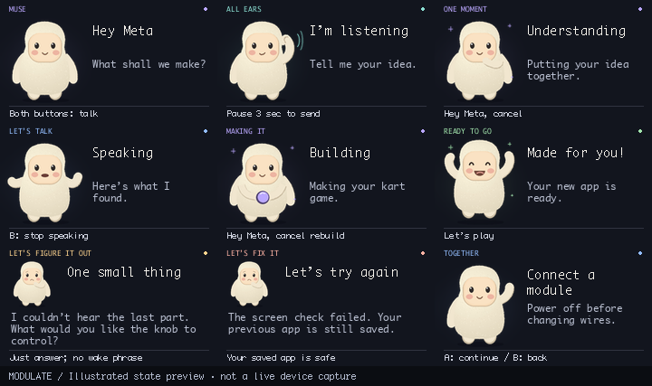

# Muse on the mini screen

October 29, 2026. The trusted Pi presentation layer draws a custom, animated
Muse-inspired companion over the existing voice/build states. This changes
presentation, not the agent's tools, wake detector, generated packages, or
permission model. Generated games still own the screen while being played.

## States

| Actual device state | Character behavior |
| --- | --- |
| Startup or idle without an app | Gentle breathing and blinking |
| Confirmed wake, push-to-talk, or direct follow-up listening | Hand cupped beside the hood, listening waves |
| Transcribing, queued/fetching speech | Thinking pose; no talking mouth |
| Actual speaker playback | Moving mouth and conversational arm gestures |
| Active build/check/repair | Holding a glowing orb, blinking and small sparks; actual stage remains visible |
| Clarification or error | Concerned face and hand-to-chin pose with the explanation |
| Newly confirmed game/control activation | Brief happy bounce, then the actual generated app |
| Other instructions | Friendly raised hand with the existing guidance |

Ambient wake-word monitoring does not cover the running app. A success card is
scheduled only on the matching `activated → confirmed` device transition, after
durable activation. Model completion, a restored startup revision, a replayed
acknowledgement, failure and cancellation cannot trigger it. Existing overlays
take priority; an unseen celebration expires after eight seconds. A visible
celebration lasts 1.25 seconds and pauses application rendering/input.

Setup codes, pairing confirmation, the library, live system volume/brightness
and generated game/camera screens retain their existing behavior. The character
does not replace those functional screens. Stop-speaking, cancellation and
direct-answer guidance remain available. Long card text wraps using the actual
font metrics and pages every 3.5 seconds instead of silently losing words.

## Implementation and preview

`modulate/muse_screen.py` uses the existing Pillow dependency. The character is
drawn at 3× and downsampled, with stable fur texture, breathing, blinking,
hand poses and a playback-gated mouth cycle. This is expressive animation,
not phoneme lip-sync. Up to 96 native RGBA character frames are cached (about
4.27 MiB of pixel data); the display writes at no more than eight frames per
second for these cards. There are no animation-time model/network calls, new
provider dependencies or new credential requirements.

Reproduce the **offline illustrated preview** (not a physical screen recording):

```sh
.venv/bin/python -m scripts.preview_muse --output context/evidence
.venv/bin/python -m unittest tests.test_muse_screen tests.test_device_muse -q
```



[Animated preview](evidence/muse-states.gif). Synthetic tests check lossless
text paging, native text bounds, frame ownership, distinct hand/mouth movement,
display-write throttling, overlay priority and activation acknowledgement rules.
The full local suite ran 921 tests with 11 platform skips. Hardware deployment
and physical observations are recorded separately in the build log.

Installed on the Pi as `89b29d8`: all 260 focused Pi checks passed. The user
confirmed seeing the cupped-hand listening pose and mouth animation during
speech. The existing app revision was retained. Success/error lifecycle checks
are synthetic; this trial does not claim optical validation of every state.
[Sanitized deployment and trial evidence](evidence/muse-screens.json).

## Visual provenance

The user requested Meta's Muse character and supplied a hand-drawn pose sketch.
The illustration was drawn in project code during this event, based on the
cream fuzzy body, peach face, small black eyes and rosy cheeks visible in
[Meta's official Muse page](https://ai.meta.com/muse/) and its
[full-body product artwork](https://lookaside.fbsbx.com/elementpath/media/?media_id=1753800308869917&version=1788802033&transcode_extension=webp).
Meta's [design article](https://introducing.muse.ai/) describes customizable
avatars; the unadorned official reference was used here.

Meta's character design/brand remains Meta's. This is a custom Modulate
adaptation, not an official Muse avatar SDK, licensed asset pack or an
endorsement. No official source image, downloaded video, private screenshot or
user sketch is redistributed in the repository. No open redistribution license
was found for the official artwork; public availability is not such a license.
