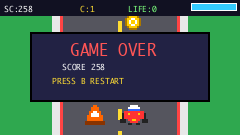
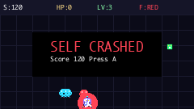

# Modulate product runtime

Implementation snapshot: October 28, 2026. A typed Meta request generated Pixel Kart Sprint on the Pi, with confirmed steering/buttons; a later spoken request generated MODULATE: Self Assembly. The same device controls native Mac volume; PTT/hands-free speech refined sensitivity, direction and step size. Two UI rollbacks restored mappings without model calls. This completes the main game/control/spoken-refinement prototype loop. Initial audio failures, limited wake evidence and performance constraints are recorded below. The earlier [number prototype](number-prototype.md) has separate evidence.

The computer-task extension completed a typed live Meta local-form trial and, after an earlier failure, a spoken Gmail latest-email readout. Independent visible-browser inspection verified the subject and the user confirmed hearing the answer. Three separate subjects and general reliability were not established. Star Dash — Astronaut Runner remains retained. Setup and privacy boundaries are [separate from the demonstrated volume bridge](#computer-tasks-and-spoken-replies).

## Install the host

Use a dedicated virtual environment on macOS. The recorded host is Python 3.14.7; these instructions require Python 3.11 or newer. The current native volume backend supports macOS only. OpenSSL must be on PATH for local TLS certificate creation. The browser UI has no package manager, build step or external JavaScript dependency.

```sh
python3 -m venv .venv
.venv/bin/python -m pip install -r requirements-product-host.txt
.venv/bin/python -m unittest discover -s tests -v
node --check modulate/web/app.js
```

The last command is optional static JavaScript validation and requires Node. The Python checks use fake providers and host actions; they do not spend API credits or adjust the computer's volume. The runtime tests execute bounded, handwritten test fixtures in actual isolated workers. They do not count as model-generated game evidence.

Put the account's Meta API credential in `context/private/meta.env` as `MODEL_API_KEY=...`, using an editor, then set file mode `600`. The loader accepts literal `NAME=value` lines, not shell commands or `export` statements. Keep that file and all runtime state ignored by Git. No model credential goes to the Pi or browser.

Start the local studio from the repository root, substituting the current computer and Pi addresses. Both address arguments are literal IP addresses, not hostnames. The selected host address must be reachable from the Pi.

```sh
.venv/bin/python -m modulate.studio \
  --host-address '<HOST_LAN_IP>' \
  --device-address '<PI_LAN_IP>' \
  --state-dir context/private/product \
  --env-file context/private/meta.env \
  --provider meta --model muse-spark-1.3 \
  --budget 50
```

The budget argument is an explicitly selected dollar ceiling for this local ledger; `50` is the current user-authorized **total** development ceiling, replacing the earlier $5 ceiling. It is not an additional $50 or an estimated cost per game. The default is zero, which blocks paid calls. Keep the same state directory and ledger: conservative reservations and uncertain charges survive the ceiling change. This accounting is not a provider account balance or a guarantee against charges outside this process. Do not delete the ledger or raise the ceiling without explicit authorization.

The latest recorded API snapshot is **147 calls / $5.343662 held or used** under the **$50 total ceiling**. Earlier checkpoints were 129 calls / $3.804505 and 138 calls / $5.302247; the ceiling change retained existing usage and unknown-cost holds. These are recorded snapshots, not continuously current totals. The explicitly authorized **120-minute Chrome grant was enabled**, expiring **October 28, 2026 at 11:56:15 PM Eastern** (`2026-10-29T03:56:15.193006Z`). Studio's approximately 117-minute countdown and Stop control were checked. The recorded grant expires; it is not permanent authorization.

**Star Dash — Astronaut Runner**, revision `ea33eb8db3035c38d02cf367ddb3378da1eb3d4acbb1b249bac4f7d7e44d5382`, was retained across restart and the email trial, superseding Metro Dash as the latest recorded game. The first renewal attempt was rejected because Chrome was behind Codex; the later 120-minute grant succeeded. The [computer and speaker evidence record](evidence/computer-and-speaker.json) preserves earlier failures and the final typed/spoken trial outcomes without email contents.

Open `http://127.0.0.1:8787`. The browser service binds to loopback; the separate controller endpoint uses TLS on port 8788, a bearer enrollment key and an exact peer-address allowlist. The studio writes its certificate and enrollment record into the private state directory. Protect the private key and enrollment record; the enrollment key is a credential.

The Meta, Fireworks and Ollama adapters are implemented with explicit endpoint/model configuration. Meta `muse-spark-1.3` completed both an access probe and the first live game/tool loop on October 28. This establishes this account's tested access, not fresh-account availability. There is no automatic provider or preset fallback.

## Prepare the Pi

Use the existing Pi 5-compatible OS and preserve its files. Enable SPI and I2C, and grant the device user the access needed for GPIO, SPI, I2C and audio. The [hardware guide](hardware.md) covers physical assembly; power down before changing it. Do not run two applications that own the PiTFT pins or microphone at once.

On the tested Debian-based Pi, the OS supplies `python3-venv`, `python3-pil`, `python3-lgpio`, `libseccomp2` and `libportaudio2`. Install any missing prerequisites through the OS package manager, then create the product environment from the repository root:

```sh
python3 -m venv --system-site-packages .venv
.venv/bin/python -m pip install -r requirements-product-pi.txt
```

Recorded direct package versions are pinned in that requirements file; unrelated OS Python packages are deliberately not copied into it. The tested Pi uses Python 3.11.2, Pillow 9.4.0 from the OS, libseccomp 2.5.4 and PortAudio 19.6.0. The runtime fails closed if its operating-system sandbox cannot be installed.

The voice worker uses cached faster-whisper `tiny.en` weights, CPU/int8 and two CPU threads. Prepare that cache once while online using the same Pi user and virtual environment:

```sh
.venv/bin/python -c "from faster_whisper import WhisperModel; WhisperModel('tiny.en', device='cpu', compute_type='int8')"
```

This downloads third-party model weights when absent. The product voice worker itself requires the cache and does not download models during a spoken request. It chooses a single USB microphone only when selection is unambiguous; inspect device indices with `.venv/bin/python -m sounddevice` if needed. Bluetooth audio is not established by the working USB path.

Transfer only the studio's `device-enrollment.json` and public `device-cert.pem` to a private directory on the Pi through an authenticated channel. Keep the certificate alongside the enrollment file because its `ca_file` is relative. Do not transfer `meta.env` or the host's TLS private key. Keep both computers' state directories outside public artifacts.

Start the product device service from the Pi repository root:

```sh
.venv/bin/python -m modulate.device \
  --state-dir context/private/device \
  --enrollment context/private/enrollment/device-enrollment.json
```

The host must be running and the configured IPs current. A changed host address may require a new certificate/enrollment record because the certificate is bound to the configured IP. Pass `--microphone N` for an explicitly selected sounddevice index if USB selection is ambiguous. The first live game, native volume and spoken refinements used this product device path.

The tested Pi runs the installed/enabled [`modulate-device.service`](../deploy/modulate-device.service) as user `pi`, with `NoNewPrivileges=yes`, `KillMode=mixed` and restart on failure. Its template uses `/home/pi/modulate-product`, a `state` directory there, and `device-enrollment.json` beside the code. Adjust these paths for another deployment, use the intended state/enrollment, and stop a manual process before starting the service. These fixed paths differ from the relative private-directory commands above. Inspect the service with `systemctl status modulate-device.service`; the Mac studio must still be running.

## Use the companion

The request composer sends text to the actual agent; example buttons fill the composer and do not run automatically. Text is a development fallback, not voice evidence. The microphone help does not ask for browser microphone permission. The device voice path owns microphone capture.

The timeline records model/tool events and optional coder, artist and reviewer work. Specialists share the same call and spending budget and cannot activate packages. Code and checks shows actual candidate/active source, sprite data and recorded verification results. The image is labeled **Host preview**; it is not optical confirmation of the physical display.

During a request, the Pi shows a processing card and the companion says **Processing your request**, with the actual stage and current tool/role. The current program is retained but paused while that card is shown; the host preview may therefore show its last frame. Ordinary spoken/PTT requests are suppressed. With wake listening enabled, the local matcher still accepts “Hey Meta, cancel rebuild,” “Hey Meta, cancel build,” or “Hey Meta, stop building,” or simply “Hey Meta, cancel.” Cancellation targets the current job, adds no model request and remains visibly busy until the outstanding worker stops. It does not undo an already committed activation or volume change. A lost connection is reported as unknown status. There is no estimated percentage.

Recognized microphone requests first appear as editable transcripts in Studio for three seconds before model processing. **Edit** pauses the deadline until **Send now**; **Discard** or the local cancellation phrase discards the draft. This review window is separate from the three seconds of silence used to finish recording. If the model uses `ask_user`, its question appears in Studio and on the Pi; the next typed or spoken reply includes the previous request and question. A short answer such as “blue,” “slower,” or “yes” is valid. Keep current app dismisses a clarification. A live Meta test using an explicitly synthetic transcript produced a clarification without changing the game; a held draft was edited and discarded through the actual Studio UI with zero new model calls. Physical voice validation is recorded separately below.

The loading update is deployed. The user confirmed Listening → processing during DotDash. A later trace collected 60 samples over 30.34 seconds: all 59 busy samples reported `processing` across planning/checking/activating stages, then ready/game. This establishes sampled software state, not continuous optical visibility. Final restart checks retained the exact game revision twice. [Sanitized evidence](evidence/processing-and-restart.json).

Click Pair in the Mac card. The studio sends its single-use, two-minute code through the already enrolled TLS connection to the Pi. Compare it with the code beside “Link this Mac?” on the PiTFT, then press screen button A to allow or B to decline. The normal flow requires physical confirmation, not a terminal command. Pairing grants the fixed bridge's volume capabilities, not arbitrary computer access. The initial generated control package supports encoder movement mapped to system-volume deltas. Revoke removes grants; rollback restores the previous checked package through activation and does not undo volume changes already applied. Keep live control disabled until physical motion, scale, target and revocation have been verified.

For development only, the device CLI also accepts `--pair-code CODE` with the same state directory and enrollment arguments, writes the grant and exits. The running device reloads it. This bypasses the physical confirmation UI and should be disclosed if used for a demo.

The voice worker starts muted, but the product requests wake listening automatically after the Pi connects. Use the companion's Wake listening switch to turn it off. Local transcription uses an anchored “Hey Meta”/“Hey Metta” match, not an official Meta assistant integration or dedicated wake-word model. Hold both PiTFT screen buttons for at least 0.75 seconds to start push-to-talk. Wake/PTT requests end after three seconds of non-speech, preserving shorter pauses and corrections. Audio reaching the 25-second cap is discarded; PTT with no speech ends after eight seconds. Ambient recognition stays in passive `wake_listening`. A local wake-only probe follows 0.5 seconds of non-speech while capture continues. Bare/repeated wake phrases arm a six-second window to begin speaking; they never become a model request. Final recognition may still pause capture.

**Wake repair installed:** commit `dc5c213ec0113adb6435cfd1b21647131a4d72fa` replaces the fixed RMS threshold with Silero VAD bundled in pinned `faster-whisper==1.2.1`; no additional model download is needed. A negative ambient wake probe can retry after subsequent speech instead of blocking a later wake phrase until a full three-second quiet interval. Results stay bound to their originating buffer. Speaker-unavailable retries no longer invalidate capture, and status callbacks are ordered. The restarted Pi is connected and reports `wake_listening` without an error; the physical wake check is still pending. Audio remains in bounded memory, and software readiness is not a noise/false-trigger reliability result.

Validation: **164 focused Pi tests passed without skips in 3.260 s**. The host ran **435 tests with 11 skips** (eight lacking NumPy and three lacking PyAV); the eight SpeechActivity tests separately passed under a host Python with NumPy. On the actual Pi, the bundled ONNX adapter labeled **0 of 1,000 synthetic zero-PCM 25 ms blocks** as speech in **0.229 s**, excluding model construction. This checks compatibility and execution time, not live audio or wake accuracy. The latest user program, revision `2d24f9ab84e5cd66881f2f6972fc1c29cbf361520173a81278af84b872b510da`, survived restart. The host was not restarted, preserving its current Chrome grant.

The USB microphone supports native 44.1/48 kHz capture but rejected the product's direct 16 kHz stream. The deployed worker captures 48,000 Hz mono int16 in 1,200-sample/25 ms blocks and uses PyAV 12.3.0 to resample to 16,000 Hz, 400-sample blocks for VAD/Whisper. Initial PTT/wake attempts then hit stream overflows. A 0.25-second capture-latency setting and retry/buffering fixes preceded the successful spoken trials below; retain those failures in the evidence. All 34 focused voice tests passed on the Pi with actual PyAV, including synthetic audio and duration/filtering checks. The companion displays actual device voice state/errors. The earlier number prototype used ALSA conversion and retains separate evidence.

Logical game `button_a` is PiTFT A or the green Qwiic button at `0x6E`; `button_b` is PiTFT B or the red Qwiic button at `0x6F`. Both external boards were independently identified after a power cycle with firmware value 259, and the user confirmed their game input. Pairing confirmation and the push-to-talk chord use the physical PiTFT buttons only.

## Computer tasks and spoken replies

The user requested real computer interaction, such as “Hey Meta, read my email,” through the visible browser rather than a Gmail API. The agent has `computer_observe` and `computer_act` tools backed by an independent native Python helper, separate from volume pairing and generated packages. Native inspection reports Screen Recording and Accessibility granted. The earlier local-form trial used an authorized 15-minute Chrome session; the final spoken Gmail trial used the explicitly renewed 120-minute grant and screenshots sent to Meta.

**Live typed trial:** job `9c709269463a41efb253cac586d5e233` used eight Meta calls to enter the requested phrase in a local test form, click Verify and observe Verified. Independent browser inspection confirmed the phrase and confirmation state; the user heard the Pi's final answer. Dodge Fall remained retained during that trial. The ledger snapshot then was **94 calls / $0.672202**, including earlier activity, not this request's price. This followed the coordinate fix in commits `3713dc2` and `6c1d5e0`. It establishes the typed local-form path. The subsequent spoken request for the three newest Gmail subjects failed; it is not completed evidence.

**Final spoken Gmail trial:** job `c9daab72dd504723ad68ec514153c159` completed in **five Meta calls**, with **one `computer_observe` and two successful `computer_act` calls**. The answer gave the latest email's sender and subject. Independent inspection of visible Gmail verified the exact subject; the user confirmed, “It read them aloud.” This demonstrates a spoken latest-email readout, not three independently verified subjects or broad reliability. A subsequent spoken question about API use received an explanation of the native screenshot/cursor method. No email contents, sender names or subjects are published here.

Install the optional macOS dependencies in the host environment:

```sh
.venv/bin/python -m pip install -r requirements-computer.txt
```

After consent to both local control and sending visible screenshots to Meta, grant the helper's actual launching process Screen Recording and Accessibility through macOS settings. Existing Codex permissions do not establish that this separate process has access. Studio reports the observed permission state. Put Chrome's intended window wholly on the primary display and frontmost, select the authorized duration, then use **Enable computer control**. Deployed API support accepts 1–120 minutes with a 15-minute default; the UI offers 15 minutes, one hour or two hours. All 69 focused computer/AssistantIO/Studio tests passed, as did JavaScript syntax and whitespace checks; the enabled grant and spoken readout are separate live evidence. Every grant retains explicit expiry and stop/revoke controls and is fixed to the window's identity and geometry; changing focus or moving/resizing can require a fresh session. The helper supports at most 100 actions, each using a fresh single-use observation no older than 30 seconds. It does not expose a shell, arbitrary-app selection or clipboard-reading tool.

Update `f4e09e7` lets the first computer observation in each new task focus the exact granted Chrome window once, after identity/geometry checks. Failed focusing consumes that attempt; tool retries never repeatedly refocus Chrome. Later loss of focus still blocks actions. The update also provides transient spoken failure feedback and at most two repairs of malformed model responses within existing call/budget limits. A rejected response executes no actions. Validated usage settles its charge; unknown usage retains the full reservation. The final spoken Gmail trial above supplies live evidence beyond these tests, without proving every failure path.

The computer tool's click coordinates are integers on the screenshot's **normalized 0–1000 grid**, not image or desktop pixels. `(0,0)` is top-left and `(1000,1000)` bottom-right; the helper converts to the granted window's logical screen coordinates. Bring-up exposed Chrome's small sharing badge being mistaken for a browser window, PyObjC integer normalization, and the wrong coordinate convention; those paths were corrected. Capture uses the visible rectangular Chrome area and may include overlays in front of it.

Use **Stop computer control** to revoke access; cancelling the request also stops further actions. Moving the pointer to a primary-screen corner invokes the input library's failsafe. A dispatched click may already have taken effect, so cancellation is not undo. The model must avoid scripts/developer consoles and ask before actions such as sending, deleting, buying, publishing or changing permissions; Studio shows **Approve**/**Decline** when it requests that confirmation. These semantic instructions are not a hard Chrome sandbox or a guarantee that every consequential action will be caught. Leave passwords and authentication changes to the user.

Screenshots and screen-derived responses are held in memory rather than written to trace artifacts. Private computer tasks lose package-writing/delegation tools; the device's current game remains intact. Responses and pending speech expire after two minutes. Screenshots are sent to the selected Meta vision endpoint for reasoning, so local non-retention does not imply provider non-retention. Do not publish private browser content as demo evidence. The [architecture](architecture.md#computer-tasks-and-spoken-replies) records limits, source attribution and the distinction from the installed Codex plugin.

The Pi speech worker uses the OS packages `espeak-ng` and `pulseaudio-utils`: eSpeak NG produces audio in memory, piped to `paplay`. A single available playback sink can be selected automatically; use `MODULATE_SPEAKER_SINK` to select an explicit sink if ambiguous. Playback errors do not silently redirect to another output. Unavailable output is checked every five seconds with a two-second discovery timeout; recovery requires that same selected sink. Replies are bounded to 1,200 characters and a 90-second playback limit. These packages are installed. After an initial silent attempt, volume was set to 40% and a manual sink-name typo corrected; the user heard standalone speech, Studio's **Test speaker**, and the live typed local-form task's final reply through USB Jieli.

Use **Test speaker** in Studio to check audibility and **Stop audio** to interrupt. On the Pi, physical screen button B stops speech; holding both screen buttons invokes PTT after interrupting output. The microphone is paused while speech is queued, playing or stopping, with a short cooldown before listening resumes. A speech acknowledgement means the device accepted the message, not that the user heard it. The Pi passed 92 earlier speaker/device tests and 46 final device checks. Star Dash remained retained through the user-heard Gmail reply. Physical interruption and room echo behavior remain additional checks.

## Generated package and execution contract

Applications are JavaScript packages loaded by a fixed runtime; they are **not flashed firmware**. Voice review and clarification do not give the model new hardware or host privileges, and there is no numeric intent-confidence guarantee. A game package contains exactly `kind`, `title`, `code`, `assets` and `controls`. `kind` is `game`; `assets.sprites` maps IDs to `{width,height,palette,pixels}`, with integer-indexed pixel rows and hex-color/transparent palettes. Generated sprites are required, with no preset game substituted for a failed call.

JavaScript defines `init()`, `update(state,input,dt)` and `draw(state)`. State is a bounded JSON object. Input includes joystick axes, encoder delta, button A/B and encoder press; only connected capabilities may be requested. Drawing returns clear, rectangle, circle, line, text and sprite commands for a 240×135 landscape canvas. Off-screen coordinates are bounded and clipped by the trusted renderer. See the exact maintained contract in [`agent.py`](../modulate/agent.py), [`game_runtime.py`](../modulate/game_runtime.py) and [`game_worker.py`](../modulate/game_worker.py).

Fractional coordinates are rounded to integer pixel edges before drawing. Rectangles use half-open edges; a positive subpixel width/height can cover zero pixels and is skipped. Sprites use nearest-neighbor integer scaling and preserve transparent palette entries. Rendering tests cover these cases on both host and Pi Pillow versions.

| Boundary | Enforced limit |
| --- | --- |
| Package / JavaScript / state | 128 KiB / 40 KiB / 64 KiB |
| Sprites | 1–16, each up to 32×32 pixels; at most 8,192 total pixels |
| Drawing | At most 128 commands per frame |
| Engine memory / stack | 32 MiB / 256 KiB |
| JavaScript CPU | 100 ms startup; 20 ms per update-and-draw call |
| Parent wall-clock timeout | 4 s startup; 350 ms per frame request |
| Worker lifetime | 300 CPU seconds cumulative; Linux address space capped at 256 MiB |

The persistent QuickJS-NG worker receives no host callbacks, environment secrets, DOM, module loader, filesystem or network API. It runs with a minimal environment and a temporary working directory. macOS applies an OS sandbox; Linux applies a seccomp syscall-denial filter. Startup probes check that file open/write and sockets are denied. This is native-engine isolation with defense in depth, not a virtual machine or proof against every engine/kernel exploit. The cumulative CPU cap also means an active game can eventually require restart.

The fixed verifier runs startup and 48 representative updates, validates every output, observes a supplied sprite, and runs separate CPU, memory, state-size and command-count attack probes. It binds the report to the exact candidate and capability manifest. These finite checks do not establish game quality, all possible gameplay paths or long-term reliability.

## Evidence recorded so far

- Voice-polish validation snapshot: 313 local tests ran with three PyAV-dependent Mac skips; all 164 focused Pi tests passed with actual PyAV and no skips. The user confirmed repaired wake acknowledgement and hands-free cancellation of a held request. A synthetic transcript and a real, explicitly wake-invoked weak utterance each elicited a live Meta clarification. Actual Studio editing/discard preserved the game and added no model calls. The user also dismissed the real clarification by voice. See [sanitized evidence](evidence/voice-review-cancellation.json). Synthetic/mock test effects remain distinct from live observations.
- Latest validation after `f4e09e7`: 417 local tests ran with three Mac PyAV-dependent skips. The Pi passed 46 final device checks after its earlier 92 speaker/device tests. Earlier snapshots were 390 local tests with three skips and 57 focused computer/provider/privacy/HTTP checks after the coordinate correction. These are separate runs, not additive coverage counts.
- The duration integration passed 69 focused computer/AssistantIO/Studio tests plus JavaScript syntax and whitespace checks. The 120-minute grant was subsequently enabled with its countdown/Stop UI checked, and the spoken Gmail trial completed with independently verified subject and user-confirmed audibility.
- The earlier typed local-form success and failed spoken Gmail attempt remain separate evidence. Later voice requests created/refined Metro Dash and generated Star Dash; the latter remained retained across restart and the final email trial. Three subjects and general reliability were not independently established.
- All 13 focused game-runtime tests passed on both macOS and the Pi, using real sandboxed workers.
- One small handwritten runtime fixture on the Pi completed 120 updates paced at 30 Hz in the same worker: median step 0.237 ms, maximum 0.544 ms. This excludes display transfer, rendering, audio and physical input. It is not a generated-game frame-rate claim.
- The companion JavaScript passes `node --check`; static DOM checks found no duplicate IDs or missing script targets. The launched studio rendered in a browser using its actual API. This does not yet prove all actions or a physical device frame.
- A live Meta `muse-spark-1.3` text probe succeeded with 14 prompt and 56 completion tokens (70 total, including 46 reasoning tokens within completion), estimated cost $0.000256 under the approved development ceiling; the later game run is recorded below.
- Pi-to-Mac TLS connection worked with the pinned certificate and peer allowlist; an invalid heartbeat was rejected with HTTP 400. This verifies transport/error handling, not a completed device activation.
- Both Qwiic boards read back at their distinct `0x6E`/`0x6F` addresses after a power cycle, firmware 259; all input-device statuses reported ready. Across 240 live game-input samples, joystick X reached −1 and 1 and both logical buttons reported pressed. Encoder motion was absent from that initial window but subsequently captured during the native-volume demonstration.

## First live generated game — October 28

The first typed game request produced **Pixel Kart Sprint** through Meta `muse-spark-1.3`. The live run used 11 model calls, including a coder delegation the orchestrator chose after a malformed `write_package` call. That failure was returned as a tool observation; the agent recovered, produced a checked package and activated it in approximately 49 seconds. No preset game was substituted.

- Revision: `3d32f71658c380b6be6d88cf84ea90cf72b3dffbc4d3adc5da1f60cb98466a4c`.
- Generated source: 4,588 bytes of JavaScript; three generated sprites: coin 8×8, cone 10×10 and kart 14×10.
- Model request cost: $0.118436; cumulative cost including the access probe: $0.118692, within the approved $5 ceiling.
- Physical evidence: user confirmed Pixel Kart Sprint visible on the PiTFT, working steering, and both large green/red buttons. The live input sample described above corroborates joystick X and button events.
- Observed full-Pi rate: 13.4 fps in this run. This includes the device loop and is separate from the earlier 30 Hz runtime-only fixture; no sustained minimum frame rate is established.



This saved game frame contains the model's original generated pixel art. It records package output, not an optical photograph of the Pi; physical confirmation comes from the user's separate observation. The request was typed, so this result does not establish voice-to-game success.

## Further spoken game — October 28

The user's spoken “Make yourself” request arrived through the voice endpoint at 19:36:53.346 Eastern and completed at 19:37:31.199, approximately 37.9 seconds of agent request time after transcription. Meta generated **MODULATE: Self Assembly**, revision `4cc9b21f4e0be9f51e8ed10e8238931edbb0a8e2e186adc27d2eaaff6a3561d8`, using eight model calls with no tool failures. The package contains 4,684 JavaScript bytes and four generated sprites: `mod`, `bugR`, `bugB` and `chip`. The Pi reported about 13 fps; the voice history showed no stream overflows while this game ran. This does not establish sustained performance, noisy-room reliability or detailed gameplay quality.



The image is a saved generated frame, not an optical photograph. The loading delay prompted the processing-card work above. Runtime guidance asks future games to begin on title/instructions and wait for a deliberate button press; it does not retroactively change existing packages or independently prove compliance.

## Live volume and spoken refinements — October 28

The paired-volume request generated an encoder `volume.delta` mapping with scale **+2**. The user confirmed correct knob direction; a private live trace captured nonzero encoder deltas and native volume values across 0–100. Independent `MacOSVolumeBackend.get()` reads confirmed OS values, rather than browser media volume alone.

| Trial | Input and result | Agent request window, Eastern | Evidence identifier |
| --- | --- | --- | --- |
| Initial volume mapping | Typed request → scale +2; six Meta calls; request cost $0.021884 | 19:26:25.505–19:26:32.102, about 6.6 s | `a7c69feba78b40a0bb5115d1a740e72b` |
| Sensitivity refinement | Six-second PTT capture transcribed “Make the knob less sensitive.” → checked scale +1 | 19:32:14.404–19:32:20.312, about 5.9 s | `4b396959dd05445c85b382ef9b766540` |
| Direction refinement | User explicitly confirmed saying “Hey Meta, reverse the knob” without buttons → checked scale −1 | 19:32:38.215–19:32:42.667, about 4.5 s | `cdfbab94d30c426facba4aba9c87b04c` |

These windows measure agent request start through completion **after transcription**, excluding capture and speech recognition. Each refinement generated a new package, passed the independent control checks and received an activation acknowledgement. Exact package revisions are:

- +2: `79ca6e4b8640f00bf66860e543be72b97ee3210f2fa634ed9991b847dc06b281`.
- +1: `3e82154f6e91dac0a2d90f7b656a682c8fd2c94865a963bd3327ba21dc2d17d0`.
- −1: `c923bb254f824d9a189263ca1b6d7f0965b250118d00b06368fd3f807aacac1c`.

A further hands-free request increased the reversed step to **−10**, revision `13ba32a3ec02a4774408aeb32389f3221344ddd67af3b4cda4b0daf1a6f32a7d`. Exact per-run costs and final session usage are recorded separately; do not treat a prior ledger snapshot as a permanent total. Keep private pairing identifiers, raw transcripts/audio and volume traces out of Git.

Two live UI rollback actions changed **−10 → −1 → −10**, returning to the exact baseline revision with **zero Meta calls**. The [sanitized record](evidence/live-rollback.json) records matching Pi software acknowledgements; it does not claim optical display readback or undo volume changes already made.

Successful spontaneous wake requests establish that the path worked in these trials; they are not a false-trigger, noisy-room or reliability benchmark. The first kart creation was typed; Self Assembly and the control refinements came through voice. Broader repeated activation/recovery, revocation, wake/noise and input-to-effect measurements remain important prototype work. See [architecture](architecture.md) and [build log](build-log.md).

## Observed failure, verified fix and final handback

Self Assembly and DotDash appeared lost after service restarts. Safe stage/category/timing diagnostics identified a shutdown race: default systemd control-group termination killed the worker while the main process was finishing a frame, incorrectly persisting a fallback. These were real failures, not deliberate fault injection. The installed `KillMode=mixed` unit sends TERM to the main process first and later kills remaining processes, matching [official systemd behavior](https://www.freedesktop.org/software/systemd/man/latest/systemd.kill.html).

A voice request generated **DotDash**, revision `fd1ec6ccaeb0a923db24330ea4a84101bdde753a796f3f49fee39d276d7d358f`, in six model calls; the user confirmed its Listening → processing transition and telemetry reported about 14 fps. A typed request then generated **Dodge Fall**, revision `04f48a68e17635d45ea4a4b6f006dc33b2b7eba1483da05e80aaf83fa9394b0d`, in nine calls. The 60-sample processing trace belongs to the latter build. A spoken cursor request was declined at that time because the host exposed volume capabilities only; this preceded the separate computer-task adapter above.

After the shutdown fix, the exact saved Dodge Fall package passed fresh independent verification and normal device activation as an explicit **cached restore, not new inference**. Service restarts at **19:59:15 and 19:59:41 Eastern on October 28** both retained that exact game revision, reported no errors and returned to `wake_listening`. These are successful software-state checks for two restarts, not a universal reliability or optical-readback claim.

That earlier handback's session usage was **60 model calls / $0.497411**, including preceding work; restore/rollback/restart checks added no model calls. At that handback, the exact temporary SSH authorized-key entry was removed, a fresh attempt with the old key was denied, and local key files/temporary Pi probes were removed. Product enrollment and the service remained intact. Later work and current ledger limits are recorded above; this historical snapshot is not the current total.
